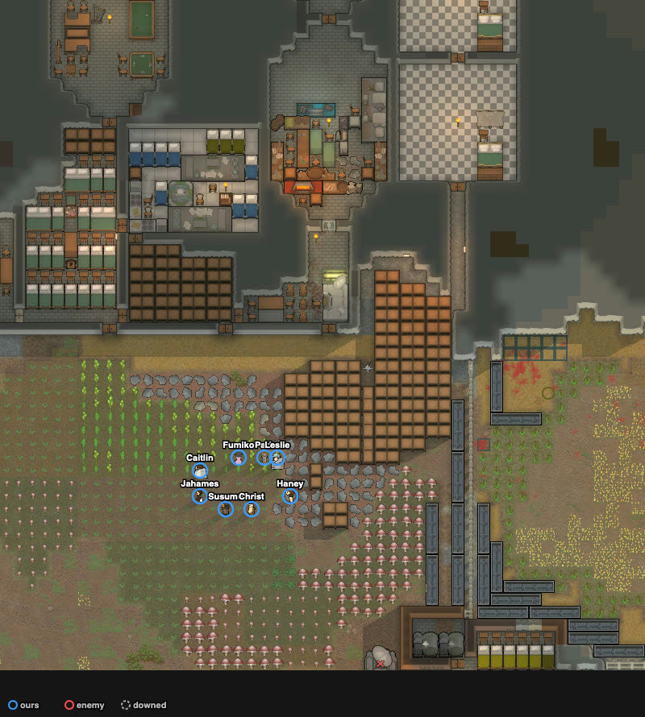
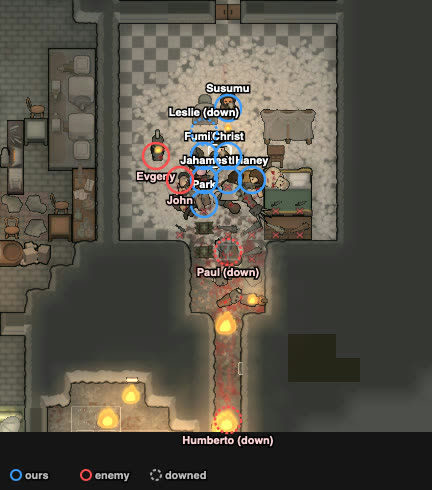

# base_ith_pirate_2x — Claude, 2026-10-06 (played alone) — civil outlanders vs 25 Waster melee, Ithfunda base — repelled

Counted play: **attempt 2**, trace `results/human/traces/base_ith_pirate_2x_claude_20261006-170538.jsonl.gz` ·
row `results/human/play.jsonl` (player `claude`) · result: **repelled** (enemies_cleared t15403),
**0 lost**, 1 downed at the end (Jahames), 1 permanent (Leslie's left ear), HP 182% · raiders: 20
dead (13 at the door or in the room, 7 on the colony's spike traps), 5 left by the edges ·
**badness 12.3** (agent `turtle` 57.4, defeat: squad down, 9 of 25 out; `results/base/ladder.jsonl`).
Sheet: `sheets/base_ith_pirate_2x_start.md` (cards rand_012, rand_118, rand_058: the one-raider
doorway and the throws into a bunch were used; written before attempt 1, used again).

Ticks below are the harness's (trace `t`). Controller ticks printed in play were game ticks − 383;
harness t = controller t − 21128885 (Dani's death: controller 21132777, last seen in the trace at
t3888).

## Attempt 1 — discarded (a context compaction came during the battle)

Trace `results/human/traces/base_ith_pirate_2x_claude_20261006-164110_try1.jsonl.gz` · row
(written by hand: the harness was stopped before the end) in `results/human/discarded.jsonl`.
The compaction came at about t5450; I played on for about 1200 ticks by mistake, then stopped.
State at the stop (t6663): none of ours dead, Jahames downed, 18 of 25 raiders standing. Same
site; the guns stood 1–3 cells behind the plug, Jahames was the first plug, and a molotov landed
in the doorway early (a thrower with Fire at will on), leaving fuel and fire beside the plug.

## Card at the start

- Ours: 8 OutlanderCivil, no loadout (the base had no items). Shooting/melee: Jahames 1/4 pump
  shotgun, flak vest (Bloodlust); Haney 2/0 heavy SMG; Fumiko 4/0 bolt-action rifle, flak pants
  (Tough); Leslie 2/0 bolt-action rifle, flak jacket; Park 0/1 revolver (Trigger-happy) with a
  firefoam pack; throwers Caitlin 3/3 frag, Susumu 4/2 and Christ 5/2 molotov. Start: the yard
  (113–120, 162–166).
- Raid: 25 Drifters (Wasters), knives and clubs only, no gun or throwable; melee 13–15: John 15
  (slate club), Farik 14, Dani 13, Daichi 13 (Brawlers), Kolya 11. From the west edge (2–9,
  87–102), ~110 cells.
- Tags: `base-arena` `raid-melee` `raid-outnumbers` `us-low-skill` `raid-far`.
- Site: the **east room** (sites.md, base arenas): 9×9 (x 129–137, z 188–196), a dead end (the
  rooms behind it to z 227 open only into it), one door (133, 187) at the top of a 1-wide corridor
  x 133 (z 179–186) that starts at the nook (126–133, 175–181) off the yard.
- Plan: the door held open; one raider at a time in the doorway; all guns on him; throws only
  into the corridor queue.

## Scenes

### t0–916 `approach` → walk in
Drafted all eight and sent them into the room; door set to "Hold open"; the throwers' Fire at
will off. Cells: Jahames (133, 188) plug; Haney (132, 188) and Fumiko (134, 188), the doorway's
two diagonal cells; Leslie (133, 189), Park (134, 189); Caitlin (133, 190), Christ (133, 191),
Susumu (133, 193) (a torch lamp stands on (133, 192)). All inside at t916.
The raid was smashing and igniting furniture in the west (hydroponics, shelves, a bed).

### t1096–1971 `approach` `raid-wrecking`
Veli, Mezzatesta and Eduard died at (52–90, 153) on the colony's spike traps (corpses there;
spike-trap frames left behind). First raider within 30 cells t2656, within 15 t2920.

### t2920–3636 `raid-wrecking`
The raid gathered in the nook and the yard (126–133, 172–179) hitting the wooden shelves. First
raider in the corridor t3636 (Dani).

### t3770–4378 `melee-contact` → `mouth-hold`
Dani (melee 13) in the doorway: dead t3892. Furr next, Humberto behind him in the corridor:
Jahames (plug) 100 → 42%; swapped for Leslie at t4271 while Furr still stood in the doorway
(the swap went through). Furr dead t4370, Humberto downed at (133, 186) t4378 (he crawled down
the corridor to (133, 180) and lay there).

### t4378–6820 `raid-wrecking` `fire`
No raider came up for ~2400 ticks: they burned devilstrand, shelves and hydroponics in the yard
(40 fires). Leslie had walked into the doorway cell (133, 187) and Jahames back onto the plug
from his rest cell: the controller had given them fire orders on raiders in the nook they could
not see, and a pawn ordered to fire walks to where it sees its target. Restricted each pawn's
targets to the raiders its own cell sees and put them back.

### t6820–7513 `melee-contact` `fire` → `molotov-into-group`
Svejgaard and Koromaru in the corridor. At t6994 all three throwers threw at Svejgaard (two in
reach, 4–5 cells from Leslie on the plug). Fire spread up the corridor; Park popped the firefoam
at t7472 (fire within 2 cells of the plug). Svejgaard dead in the doorway t7513. Changed: one
throw per step, molotovs only 6.5+ cells from ours.

### t7941–9601 `mouth-hold`
Hairy dead t7941, Koromaru t8479. **Kolya stood in the doorway from ~t8330 at 57 → 20% and then
stayed at 20% for about 900 ticks** (dead t9411); none of the front lost health either. Snuff
dead t9528. Daichi into the doorway t9601.

### ~t9900 `melee-contact` (the turning point)
Checked why. The keeper had Haney and Fumiko on hold-fire: its friendly-fire estimate counted the
plug standing next to the doorway raider. And the float menu offered **"Fire at Paul: Too close"**
to Haney (diagonal, across the rock corner), Fumiko (diagonal) and Leslie (the plug): no one next
to the doorway raider could shoot him; only Park, 2 cells back, had been firing (17 shots).
chose: a new layout — the plug alone on (133, 188), meleeing the doorway raider; the diagonal
cells empty; guns 2+ cells back on (133, 189), (132, 189), (134, 189), (132, 190), (134, 190)
firing on the doorway raider with the friendly-fire risk accepted on him alone; gun moves hold
their fire orders until they arrive (a fire order ended the walk). Scratch script `base3.py`.
followed: Park, Haney and Jahames fired on the doorway raider.

### t10246–10600 `rotation` `our-downed` → `carry-downed`
Leslie (plug) at 44%: swapped for Fumiko at t10246. Leslie never left the cell: she went down on
the plug cell at t10368 with Fumiko standing on the same cell, and Daichi struck her where she
lay ("melee attacking Leslie"). Park (132, 189), diagonal to her, took "Carry Leslie" and stood
~110 ticks with the job "carrying Leslie" without picking her up; sent to (132, 188), next to her
orthogonally, the pick-up was immediate. He dropped her at (132, 192); Susumu tended her
without medicine (drafted, float menu "Tend Leslie (without medicine)").

### t10789–10984 `melee-contact` → raider in the room
Daichi dead t10789. Caitlin's frag order on John at ~t10838 (John about 6–7 cells below the plug; the
controller's 4.5-cell check passed); the frag left her at ~t10939 and went to John's cell then,
(133, 186), 2 cells below the plug: seen over (133, 189), (133, 188), (133, 187), then lying at
(133, 186) from t11031 to at least t11103. **At t10984 John (melee 15) stepped from the doorway
(133, 187) diagonally onto (132, 188)**, past the rock on (132, 187), while Fumiko stood on the
plug cell; his job was "melee attacking Christ". I stopped the throwers (stop + Fire at will
off), sent Fumiko off the plug (the frag beside the doorway), and turned everyone on John.

### t11122 `raid-breaking`
"Wasters from Miasma Packers are fleeing." By then 13 of 25 were dead or downed (Veli,
Mezzatesta, Eduard on the traps; Dani, Furr, Svejgaard, Hairy, Koromaru, Kolya, Snuff, Daichi at
the door; Humberto and Paul downed); Farik died inside the room at about the same time (cause not
seen).

### t10984–11860 `melee-contact` inside the room
John and Evgeny inside, both "panic fleeing" (mental state) while John still struck at us. Park,
Fumiko and Jahames next to John, with "melee attacking John", did no damage for ~150 ticks
(John stayed at 49%); after "Go here" to a neighbouring cell and a new melee order, John went
49 → 26% in ~30 ticks. Then the guns stepped to cells 2–3 from the raiders and fired. Jahames
went down at (132, 190) at ~t11560 (John beside him). John dead ~t11680, Evgeny ~t11860.
Paul (downed in the doorway) had crawled in to (133, 189): shot dead at t11950. Christ tended
Jahames.

### t11635–15403 `raid-breaking`
Razor, Tony, Ryan and Kapenk, fleeing east, died on spike traps at (153–182, 118–122). Bux,
Mitsuya, Fjellsmel, Judex and Outrun left by the south, west and east edges. Humberto died where
he lay in the corridor. Leslie could walk again at t12654. Raid gone at t15403.

## What the play stood on (observed)
- One cell (133, 188) between the doorway and the room; the raid came up the corridor one or two
  at a time over ~7500 ticks (t3636–11122), with long gaps while it wrecked the base.
- Until ~t9900 only the pawns 2+ cells from the doorway raider shot him: the three next to him
  had "Fire at …: Too close". After the change the guns stood 2+ cells back.
- 7 of the 20 dead died on the colony's spike traps, 3 before contact and 4 while fleeing.
- The raid fled with 13–14 of 25 out (52–56%).
- Losses came from: Jahames (plug, t3770–4271, ~58 points), Leslie (plug, down on it during the
  swap), Jahames again inside the room after the raider got in.

## New tags / sites (for the user to look at)
- Tags: `base-arena` (situation, matchup), `raid-wrecking` (moment).
- Site: Ithfunda east room (sites.md, new section for the base arenas).
