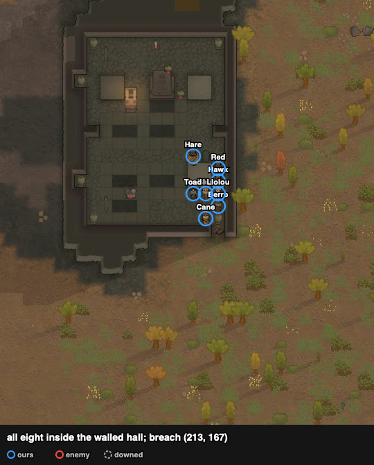
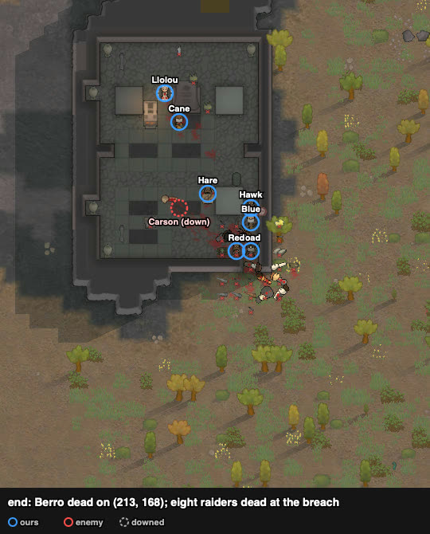

# rand_006 — Claude, 2026-10-18
Trace `results/human/traces/rand_006_claude_20261018-052806.jsonl.gz` · row `results/human/play.jsonl`
(rand_006, player `claude`) · result: **repelled** (t6727), 1 lost (Berro dead), 0 downed at the
end, 1 permanent, health lost 323% · raid: 8 dead, 1 downed, 4 fled · **badness 24.9** (agent `kite`
73.4: squad down, 0 kills)
Sheet: `sheets/rand_006_start.md` (cards rand_094, rand_118/127, rand_115/164: the mouth hold and the
deconstructed breach; the hall instead of the nook because of the raid's start)

## Card at the start
- Ours (TribeSavage ×8; shooting/melee, weapon): Berro 12/9 steel ikwa (awful), Trigger-happy;
  Hawk 7/3 greatbow; Blue 10/5 recurve bow (good); Llolou 6/6 short bow, Nimble; Cane 9/11 recurve
  bow, Careful shooter; Toad 4/1 steel ikwa (poor), Bloodlust; Red 0/0 greatbow (construction 13);
  Hare 2/5 greatbow, Bloodlust (the raid's target). No armour.
- Raid (13 Drifters, pirates; all melee): Wttytt knife 12 (Brawler), Bryan club 9, Eva club 8,
  Lainey club 8, Jumper club 7, the rest 0–4 (Carson 2, Wes 3, Kat 2, Moe 1, Andy 4, Max 4,
  Sly 3, Zornie 0); most weapons at 24–59%. From the south edge (175–187, 0–6), 133 cells.
- Tags: `open-arena` `raid-far` `raid-melee` `raid-outnumbers` `us-bows` `us-skill-mismatch`.
- Plan: the nook was out (the raid starts 86 cells from it, we 96), so the NE walled hall (95 for
  us, ~166 for the raid). Breach the south wall's corner cell (213, 167) by deconstruction (Red,
  construction 13); sight.py said only (212, 168) and (213, 168) touch it.

## Scenes
### t0–150 `us-skill-mismatch` → `loadout` `breach`
chose: greatbow Red → Berro; ikwa Toad → Cane; ikwa Berro → Llolou; recurve Cane → Toad; short bow
Llolou → Red. Deconstruct designated on the granite wall (213, 167).
followed: Red took the job by himself at t120 (no re-draft needed this time) and walked with it.

### t150–2025 `approach` → walk, `breach`
followed: Red at the wall ~t1650; the wall gone between t1845 and t2025 (~200–370 ticks), the raid's
front 59 cells away and strung out (Zornie and Wes ~20 cells ahead of the body).

### t2025–2545 into the hall
saw: (213, 168), which sight.py had as a front cell, holds a limestone urn, and a 2×2 marble table
covers (211–212, 171–172) ("No order matched 'Go here'" for those cells). The urn can be walked
through but not stood on (the user; after the battle Llolou, ordered onto another urn at (202, 179),
stopped beside it on (203, 179)). Pawns were on (213, 168) later all the same: Llolou t3906–4191,
caught there in melee on his way, with the urn still standing (27% at ~t4190); Berro from t4886
and Toad from t5444. By the end the urn was gone; what broke it, and when, is not recorded.
chose: Cane (ikwa) on (212, 168); bows on (213, 169), (212, 170), (211, 170), (213, 170), (213, 171),
(213, 172), (211, 173); Llolou (ikwa) behind. sight.py from those cells: all but Cane shoot the
breach; most see 13–25 cells of the queue outside.

### t2865–3826 `melee-contact` `raid-strung-out` → `mouth-hold`
followed: the raid came into the breach one at a time as it arrived: **Zornie dead ~t3206, Wes
~t3546, Kat ~t3802**, each in (213, 167) with the bows on it (scratch `hall006.py`, Fire at the
standing raider nearest the breach). Cane (front) 91% → 76% → 59% → **39% at t3826** (Bryan, club 9).

### t3826–4787 `our-downed` `melee-contact` → `rotation` `carry-downed`
chose: Llolou into the front, Cane out.
followed: Llolou ended on (213, 168) (the urn cell, in melee on his way), not (212, 168); with Cane
gone, (212, 168) was empty
until Hare (melee 5) filled it at t4137. **Llolou down t4191** on (213, 168), next to the breach.
Berro carried him (float menu "Carry Llolou") deep into the hall and dropped him at (209, 177)
(t4199–4636; carrying, he walked ~1 cell per 30 ticks). Meanwhile (213, 168) was empty and
**Carson got in** (~t4556) and went for Cane; three bows and two melee on him: **down t4787** inside.
**Bryan dead ~t4505** in the breach. Berro then took (213, 168) at t4886.

### t4886–5444 `rotation`
followed: Hare (front) 41% at t4906 → Red (construction 13, melee 0) into (212, 168): the swap took
~240 ticks through the crowd round the table. **Moe dead ~t5136.** Berro 100% → 56% → **43% at
t5266**; ordered out to (212, 174) at ~t5276 with Toad ordered in, he stayed "moving" on (213, 168)
and was **dead by ~t5376** (corpse on that cell). Toad took the cell at t5444. The rotation line went
up to 55% after this.

### t5444–6727 `raid-breaking`
followed: **Andy dead ~t5444, Sly ~t5625, Max ~t5826**, all in the breach; the raid fled at t5826
with 9 of 13 out. Wttytt, Lainey, Jumper and Eva walked east off the map; enemies cleared at t6727.
Red at 58%, Toad untouched.

## What the play stood on (observed)
- The breach took the raid one at a time: all eight dead raiders died on (213, 167).
- Damage dealt (records): Blue 189, Hawk 152, Hare 145, Toad 140, Red 125 (bows), Cane 80 and
  Llolou 29 (melee at the front). Damage taken: Cane 64, Hare 61, Llolou 60, Red 39.
- Each front rotation took 100–240 ticks (the table and the bows crowd the cells behind the front);
  Berro died during one, Carson got in during another.
- The urn on (213, 168) cannot be stood on, but a pawn walking through was caught there in melee,
  and later the urn was gone; so in the fight the breach had two inside cells, not one.

## New tags / sites (for the user to look at)
- sites.md, NE walled hall: the south wall's corner cell (213, 167) as the breach; a limestone urn
  on (213, 168) (walk-through, not standable; gone by the end) and a 2×2 table on
  (211–212, 171–172) inside.
