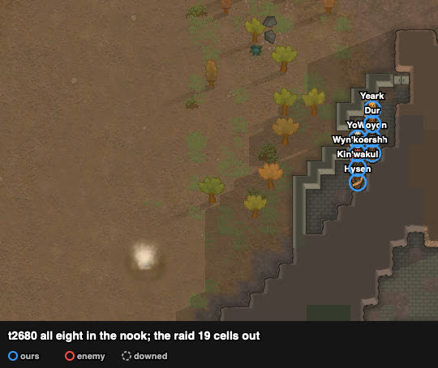

# rand_094 — Claude, 2026-10-18
Trace `results/human/traces/rand_094_claude_20261018-051552.jsonl.gz` · row `results/human/play.jsonl`
(rand_094, player `claude`) · result: **repelled** (t5515), 0 lost, 0 downed, 0 permanent, health
lost 129% · raid: 3 dead, 2 downed, 2 fled · **badness 5.2** (agent `kite` 69.2: squad down, 0 kills)
Sheet: `sheets/rand_094_start.md` (cards rand_018, rand_164, rand_115, rand_118/127: the nook mouth
hold from rand_118/127, deconstruction from rand_164/115)

## Card at the start
- Ours (PirateYttakin ×8; shooting/melee, weapon): Yeark 0/1 bolt-action rifle (poor); Yoen 4/12
  machine pistol (awful), Psychopath, Inject go-juice; Koersh 9/6 pump shotgun (good), Careful
  shooter; Hysen 0/2 steel mace (awful); Woyon 11/7 steel knife; Dur 7/2 biocoded revolver;
  Wyn'koersh 0/5 wooden club; Kin'wakul 0/5 marble club. All have Animal warcall; the map had no
  wild animals.
- Yoen: Frail, Dementia, a painful stab scar on the left leg, go-juice addiction: moving 42%,
  manipulation 42%, consciousness 79% (seen only when he fell behind on the walk).
- Raid (Neanderthal tribals, all melee): Humps ikwa 9 (Tough), Braña knife 9, White knife 6, Lion
  ikwa 5 (Fast walker, Tough), Miñoca knife 3, Rhino knife 1, Wolle club 0. From the north edge
  (130–140, 242–248), 121 cells; all targeting Woyon.
- Tags: `open-arena` `raid-far` `raid-melee` `raid-strong-1v1` `us-melee-pawns` `us-skill-mismatch`.
- Plan: loadout, the nook (rand_118/127), the mouth wall deconstructed by one undrafted pawn with
  the job given at the start (the user's rand_115), two melee pawns on the front cells and four
  guns on the raider in the mouth (cells from `rca/sight.py`), rotation below ~45%.

## Scenes
### t0–255 `raid-far` `us-skill-mismatch` → `loadout` `breach`
chose: rifle Yeark → Woyon (shooting 11); mace Hysen → Yoen (melee 12); machine pistol Yoen →
Yeark; knife Woyon → Hysen (`manage_gear` drop + equip, all done by t150). `do_thing_action`
`Deconstruct` on the mouth wall (211, 84).
followed: Yeark (construction 4, Wyn'koersh also 4) stayed undrafted but kept "wandering" to
t240, after `set_work_priority` Construction (the reply said priority 3, simple mode) and after
the other seven were drafted. Drafting him and undrafting him again gave "deconstructing marble
wall" at t255; he walked the ~96 cells with that job.

### t255–1830 `approach` → walk to the nook
saw: six of the seven drafted reached the nook's outside by ~t1740; Yoen was at (165, 108), 47
cells behind, walking ~34 ticks a cell (moving 42%). The raid at (178–181, 152–161).
chose: his gizmo "Inject go-juice" (t1790, ~40 ticks): at t1830 moving 111%, consciousness 105%,
manipulation 65% ("High on go-juice (16h)"); then Go here again.
followed: he reached the mouth with the others (t2530).

### t1740–2680 `approach` → `breach`, into the nook
saw: Yeark worked at the wall from ~t1740; it was gone at t2530 (~790 ticks of work), with the raid
27 cells from the mouth. A stack of marble blocks lay on the mouth cell.
chose: everyone in: Yoen (212, 84) and Wyn'koersh (212, 83) on the two cells that touch the mouth;
Woyon (rifle) (213, 84), Koersh (shotgun) (213, 83), Dur (revolver) (213, 85), Yeark (machine
pistol) (213, 86); Kin'wakul (212, 82) and Hysen (212, 81) in reserve. sight.py, with (211, 84)
open: the mouth is shot from (213, 83–86), (214, 85–87), (215, 87), (212, 81–82), (211, 80–82),
(210, 81); (212–214, 84) see the lane west. All in place at t2680, the raid 19 cells out.
followed: the raid did not come along the lane (z 84–85) as in rand_118: it came south along
x 206–210 from z ~105 to the mouth, Lion and Miñoca first.

### t3000–4360 `melee-contact` → `mouth-hold`
saw: Lion stepped into the mouth (~t3000); the rest queued at (209–210, 84–85).
chose: a 20-tick loop (scratch `nook094.py`): the four guns ordered "Fire at" the standing raider
nearest the mouth when within 12 cells, only when their job did not name it; the front swinging on
fire at will.
followed: one raider at a time in the mouth: **Lion dead ~t3440** (Tough: 81% → dead over ~420
ticks), **Miñoca down t3620**, **Wolle dead t3840**, **White down t4360**. Yoen 77% (t3020) → 65%
(t3560) → 45% (t3880); Wyn'koersh 81% (t3140) → 64% (t3260).

### t4360–4500 `melee-contact` → `rotation`
saw: Yoen at 45%; Braña (melee 9) next in the mouth, Humps (9, Tough) and Rhino behind.
chose: Kin'wakul to (212, 84), Yoen to (212, 82).
followed: the swap took ~140 ticks: Kin'wakul reached (212, 83) first (Wyn'koersh's cell) and
both stood on (212, 84) together for ~60 ticks; Yoen, hit meanwhile, went out at 36%. Kin'wakul
89% → 70% on Braña.

### t4500–5515 `raid-breaking`
followed: **Braña dead t4640**; the raid fled at t4640 with four of seven dead or down. Humps
(100%) and Rhino (95%) walked east along z 85–92 to the map edge (gone t5420 and ~t5490). Nobody of
ours went out. Enemies cleared at t5515; White lay downed in the mouth, Miñoca at (207, 80).

## What the play stood on (observed)
- The mouth took the raiders one at a time for ~1600 ticks of contact; nobody of ours went down.
- Damage dealt (records): Yeark 169 (machine pistol, shooting 0, 53 shots from (213, 86)), Dur 129
  (revolver, 15 shots), Koersh 126 (shotgun, 13), Woyon 89 (rifle, 9), Yoen 83 and Wyn'koersh 71
  (melee at the front), Kin'wakul 13. Damage taken: Yoen 73, Wyn'koersh 32, Kin'wakul 25.
- The deconstruction (~790 ticks for construction 4) ended with the raid 27 cells away.
- Yoen, the best melee pawn on paper, was frail (moving and manipulation 42%); go-juice made him
  reach the mouth in time.

## New tags / sites (for the user to look at)
- sites.md, nook: the mouth wall deconstructed (no attack orders); marble blocks left on the
  mouth cell; this raid came down from the north along x 206–210, not along the lane.
- RIMMOLT_API: a Deconstruct designation was not taken up by an undrafted pawn ("wandering") until
  it was drafted and undrafted again.
