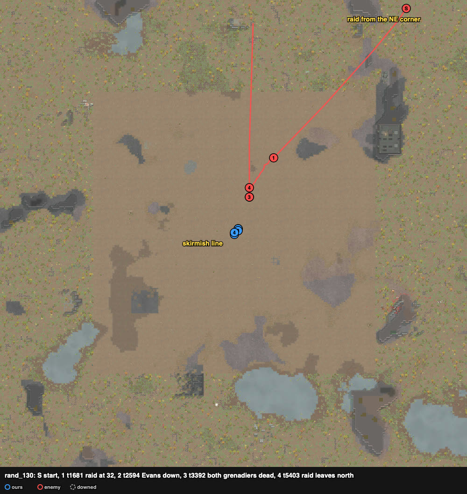

# rand_130 — Claude, 2026-10-05 (played alone) — civil outlanders ×9 (one ace) vs civil ×9 with two grenadiers — repelled

Trace `results/human/traces/rand_130_claude_20261005-165810.jsonl.gz` · row `results/human/play.jsonl` ·
result: **repelled** (enemies_cleared t7608), **1 dead** (Beatriz), 3 downed (Zhang, Rae, Missy),
HP 410% · raiders: Daiki, Athequart (both grenadiers), Cali, Kitten, Ramon dead, Evans downed;
Paul, Lui, Loser left north · **badness 35.4** (agent `doctrine` 206.0). Sheet:
`sheets/rand_130_start.md` (rand_011's play).

## Card at the start
Ours: Sammy (shooting 18, melee 19, good revolver, Trigger-happy, Tough, flak vest + jacket), Rae 9 (with
a knife), Zhang 4 revolver (flak vest), Beatriz 3 awful revolver, Petra 2 shotgun (Slowpoke),
Hakuja 2/6 autopistol, Missy 0 good shotgun, Dave 0 machine pistol, Lady 0 revolver (the raid's
target). Raid from the NE corner (212–226, 242–249), ~150 cells, everyone shooting ≤ 5:
Athequart molotovs, Daiki frags, Paul, Lui, Ramon autopistols, Loser, Kitten revolvers, Cali
machine pistol, Evans knife.

## Scenes
- **t0–136** `loadout`: Rae (9) ← Lady's revolver; Lady ← the knife.
- **t136–1681** `skirmish-line`: two rows across the NE approach. Front: Zhang (124, 132),
  Beatriz (126, 130), Sammy (128, 128), Rae (130, 126), Hakuja (132, 124). Back: Petra (123, 129),
  Missy (125, 127), Dave (127, 125) (ordered; they stood at (126, 127) and (128, 125)). Lady at
  (124, 123).
- **t1772–2594** `approach`: the raid came straight down from the NE. Sammy put Daiki (frags) to
  42% from 30 → 10 cells; Evans (knife) ran in alone and was **downed at t2594** in the line.
  **Beatriz down t2475.** Lady carried her back (she died later of her wounds).
- **t2594–3392** `raid-holds` `thrower-close`: the gunners stopped at 16–22 cells. Daiki at 10
  and Athequart at 9–16 threw. `guard` stepped the targets aside. Zhang and Missy went down.
  **Daiki dead; Athequart dead t3392.**
- **t3392–5403**: Sammy and Dave on the holders at 16–22 cells: **Cali dead t3482, Kitten
  t4667, Ramon t5403**; Rae down t4397. Lady carried Zhang back from (124, 135).
- **t5403–7608** `raid-breaking`: Paul, Lui, Loser walked off north.

## What the play stood on (observed)
- One ace: Sammy fired 36 shots for 288 damage and 4 kills; Dave (machine pistol) 66, Rae 60.
- The grenadiers came within throwing range and died there; the gunners held at 16–22 cells
  and lost one at a time.
- The four of ours lost were in the front row.
