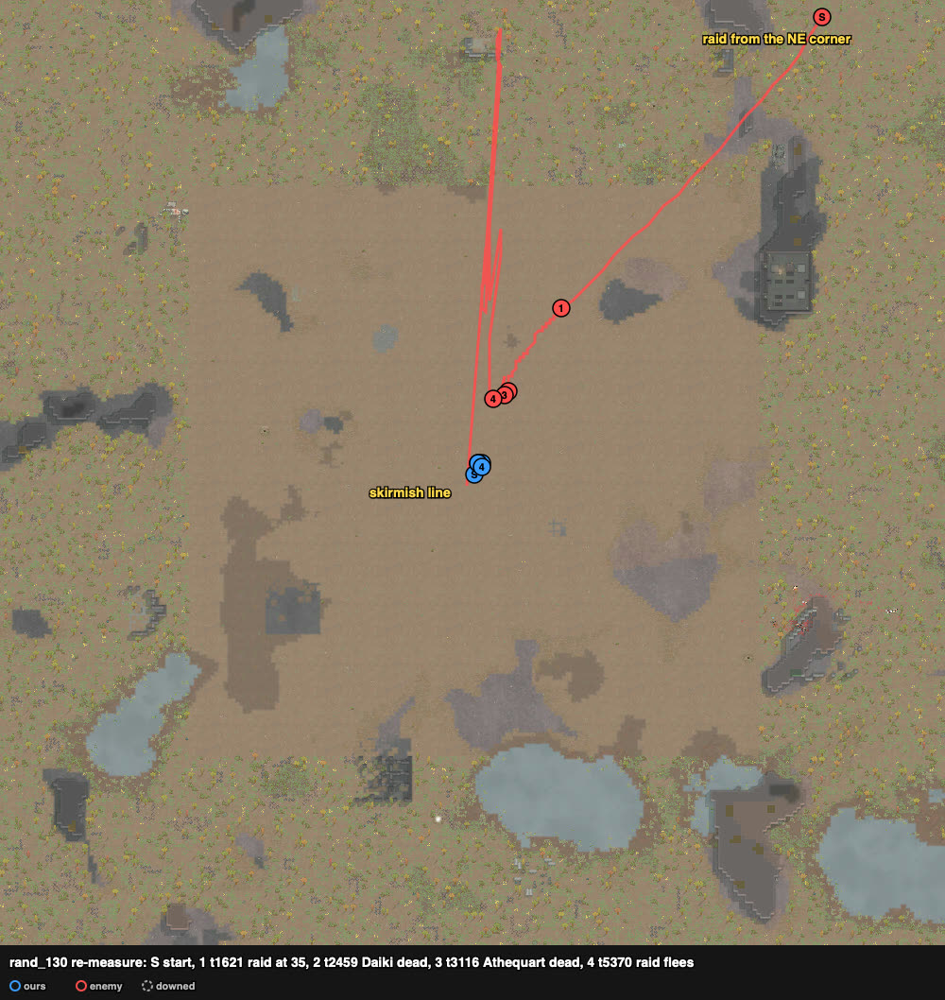

# rand_130 — Claude, 2026-10-06 (re-measure, ranged fire by `Keeper.assign`) — civil outlanders ×9 (one ace) vs civil ×9 with two grenadiers — repelled

Trace `results/human/traces/rand_130_claude_20261006-094522.jsonl.gz` · row `results/human/play.jsonl` ·
result: **repelled** (enemies_cleared t8697, raid fled t5370), **1 dead** (Zhang), 1 downed
(Beatriz), 0 permanent, HP 220% · raiders: Daiki, Athequart (both grenadiers), Cali, Loser, Lui
dead; Evans and Kitten downed; Paul and Ramon left north · **badness 21.8** (first play 35.4,
agent `doctrine` 206.0).

## Why a re-measure
The first play (`rand_130_claude_20261005.md`, ~17:00 on 2026-10-05) used `duel.py`, the same
stall rule as rand_150's first play: a new target when "Shots fired" had not moved for 3 steps.
- It ran before the mod's wait-setting change, so a step was ~35 ticks and the rule ~100 ticks.
- That is longer than the pump shotguns' aim (54 ticks), so the expected loss was small. This run
  checks it.

## An attempt stopped (no row)
The first try of this re-measure was stopped at ~t2375, and the harness was killed, so no row was
written.
- At t2369 Zhang died in an explosion. A frag lay at (125, 132) for ~110 ticks, and Zhang walked
  back and forth beside it.
- Cause: `hands.guard` re-sidestepped the same pawn every controller step
  (`results/audit_attack_orders.md`, "Grenade sidestep re-issued every call"). It was fixed
  before this run.
- In that try Sammy first took raiders other than the grenadiers. His per-shooter weight (below)
  was set from 3 to 10 during it. This run had 10 from the start.

## Card at the start
The same as the first play.

Kept the same:
- **Loadout:** Rae (9) ← Lady's revolver; Lady ← the knife (done by t120).
- **Line:** two rows across the NE approach, drafted at t120; wait until a raider is within 36.
  - Front: Zhang (124,132), Beatriz (126,130), Sammy (128,128), Rae (130,126), Hakuja (132,124).
  - Back: Petra (123,129), Missy (125,127), Dave (127,125). Lady (knife) at (124,123).
- **Lady's knife:** the nearest raider within 8 once one is within 2 of the squad.
- **Carry the downed back** with Lady (decided by hand, as in the first play).
- **Grenade sidesteps** (`guard(keep=())`).

Changed:
- **Ranged targets** come from `hands.Keeper.assign` (scratchpad `duel130a.py`).
  - Weights: Daiki and Athequart 1.5 for every shooter, and 10 for Sammy. The first play's
    priority list was Sammy → Daiki, Athequart.
  - `assign` gained per-shooter weights for this. Without them, the spread term put four poor
    shooters on Daiki and moved Sammy off him.
- **guard** now remembers handled grenades across calls, and moves pawns away from a grenade lying
  on its fuse. In the first play guard had the old per-call memory.
- **Control step:** ~6–7 ticks here against ~35 in the first play.

## Scenes
### t1621–2459 `approach` → `focus-top-threat`
- **saw:** the raid came straight down from the NE. Ramon and Evans (knife) were in front; Daiki
  (frags) was at 37 cells, Athequart (molotovs) last.
- **followed:**
  - Shooters held fire until a raider was in their own reach.
  - Sammy took Ramon at 23 (t1844), then Daiki from t1957 (19 cells).
  - Zhang took Daiki from t1919; Dave, Petra and Missy at 12–14 cells (t2030–2067).
- **Frag (t2167–2362):** Daiki's `targeting` named no one. Guard moved the pawn nearest where the
  frag was first seen, Zhang at (124,132). The frag flew ~100 ticks and lay at (125,133), next to
  Zhang's old cell. Zhang was moved to (121,134) (t2271–2362), 4 cells from it. Nobody was hurt
  by it.
- **Daiki dead t2459** at (130,139), 9.8 cells from ours. In the first play he died later, after
  t2594.

### t2459–3116 `thrower-close` `melee-contact`
- **Evans** (knife) came to 1 cell (131,127) at t2633 with four shooters on him: **down t2676**.
  Lady never went out: Evans was not within 8 of her.
- **Molotov 1 (t2859–2970):** Athequart's `targeting` named no one, so guard moved the pawn
  nearest where the molotov was first seen. That was Beatriz (126,130) → (123,131). The molotov
  landed at (131,128), 1–3 cells from Rae and Sammy, who did not move.
- **Molotov 2 (t3104–3236):** Athequart died at t3116, just after throwing. Guard then stopped
  watching grenades, because it polled them only while a thrower stood. Nobody moved. The molotov
  landed at (131,126), next to Rae.
  - Fire burned on (130–132, 124–128) until at least t3447.
  - Rae's health stayed at 88–89%.
  - Both guard gaps were fixed after this run (commit a2828a8).
- **Athequart dead t3116** at (133,138), 11.2 cells out.

### t3116–5370 `raid-holds` (19–23 cells)
- **saw:** Cali at 13, the rest at 18–23 cells, holding.
- **followed:**
  - Slow trade: **Cali dead t3617, Loser t3717, Lui t5370**.
  - **Zhang dead t3447**, "shot to death". He was at 49% at (121,134), where the frag sidestep had
    put him.
  - Beatriz went 87 → 36% over this time and was **down at t5262** at (123,131).
  - The raid fled at t5370 (Paul, Kitten and Ramon targeting the north edge).

### t5370–8697 `raid-breaking`
- Lady carried Beatriz back (in hand t5545) towards (121,119).
- Kitten went down at t5482 at (133,149). Paul and Ramon walked off north.
- Enemies cleared t8697.

## What the play stood on (observed)
- Per pawn, shots fired / damage dealt (first play → this run):

  | pawn | weapon | first play | this run |
  |---|---|---|---|
  | Sammy | good revolver (18) | 36 / 288 | 36 / 170 |
  | Rae | revolver | 17 / 60 | 30 / 138 |
  | Dave | machine pistol | 42 / 66 | 45 / 30 |
  | Hakuja | autopistol | 39 / 20 | 39 / 80 |
  | Petra | pump shotgun (aim 54) | 8 / – | 8 / 54 |
  | Missy | pump shotgun (aim 54) | 6 / – | 6 / 16 |
  | Zhang | revolver | 10 / 24 | died (not read) |
  | Beatriz | revolver | died (not read) | 28 / 22 |

- The shotguns fired the same number of shots in both runs.
- Both grenadiers died 10–11 cells out. Ours lost 1 dead, 1 downed against 1 dead and 3 downed in
  the first play.
- One run is one draw. Several things differed from the first play: the guard memory, Sammy's
  weight, the control step and the dice. This run does not separate the ordering's share.

## New tags / sites (for the user to look at)
None.
