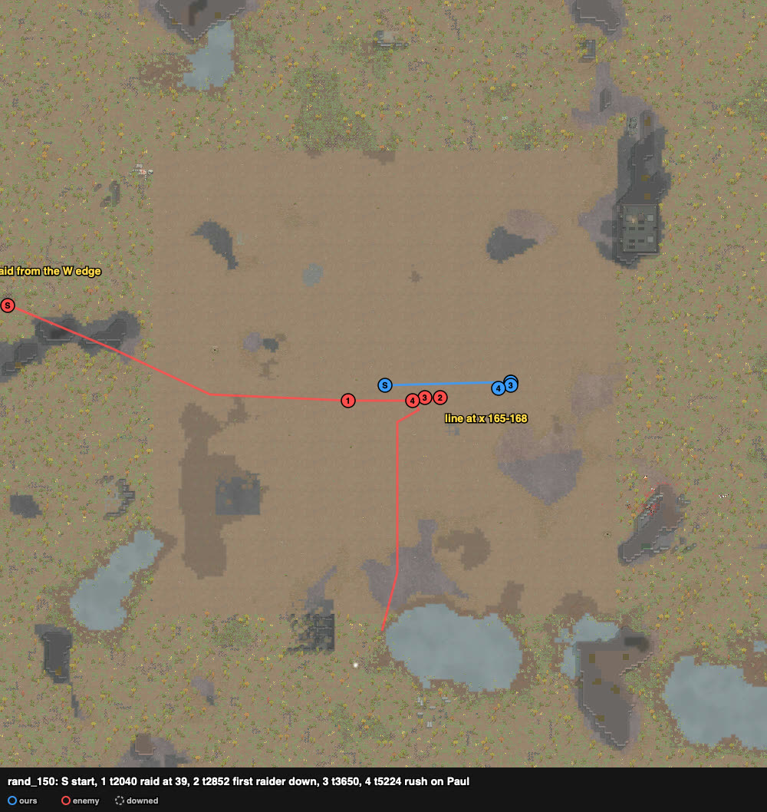

# rand_150 — Claude, 2026-10-05 (played alone) — civil outlanders ×9 vs rough outlanders ×9, gun duel — repelled

Trace `results/human/traces/rand_150_claude_20261005-170343.jsonl.gz` · row `results/human/play.jsonl` ·
result: **repelled** (enemies_cleared t7526), **2 dead** (Nytro, Ash), 0 downed, 1 permanent,
HP 360% · raiders: Brock, Meach, Pavel, Paul, Lawman dead, Kipper and Gwen downed; Hyf and
Fausto (rifles) left south · **badness 36.4** (agent `doctrine` 172.7). Sheet: `sheets/rand_150_start.md`.

## Card at the start
Ours: Lover 12 (good pump shotgun), Axle 9/12 revolver (Nimble, helmet), Queen 6/8 revolver,
Nytro 2 good autopistol, Molina 2 autopistol, Vladimir 2 shotgun, Lilu 0 bolt-action rifle,
Ash 2 and Kanze 0 knives; Molina was the raid's target. Raid from the W edge (0–6, 142–156),
~125 cells, no grenadiers: Hyf 6 and Fausto 0 bolt-action rifles, Lawman 8 good autopistol,
Gwen 4 and Kipper 2 machine pistols, Pavel 2 shotgun, Paul 1 good revolver (full flak), Brock and
Meach knives.

## Scenes
- **t0–75** `loadout`: rifle Lilu → Lover (12); Lilu ← the good shotgun.
- **t75–2040** `skirmish-line`: two rows ~40 cells east of the start, facing west. Front at
  x 165 (z 118–130): Molina, Queen, Axle, Nytro, Vladimir. Back at x 168: Lilu, Lover, Ash,
  Kanze. The raid came straight east along z 118–121, the pistols and knives ahead of the rifles.
- **t2145–3650**: the knives (Brock, Meach) reached our front and died to our knives and
  shotguns. Kipper and Gwen went down to pistol fire, and **Pavel (shotgun) died at 10 cells**.
  None of ours went down.
- **t3650–4939** `raid-holds`: Paul (42%, full flak) and Lawman held at 16–19 cells, Hyf and
  Fausto at 35. Slow trade: **Nytro dead t4744**.
- **t4939–5224** `melee-lock`: Ash and Kanze rushed Paul and the shotguns went forward. **Paul
  dead t5224, Ash dead the same moment.**
- **t5224–7526** `raid-breaking`: Lawman died coming in; the rifles walked off south.

## What the play stood on (observed)
- The raid's close-range pawns came to our line and died there (knives, shotgun, machine
  pistols); its rifles held at 35 cells and never closed.
- Lover with the rifle fired 5 shots in the whole fight. The shotguns had 2 kills each, and
  Queen (revolver) did 140 damage.
- Both of our dead came after the raid stopped at 16–35 cells: one in the slow trade, one in
  the rush.
