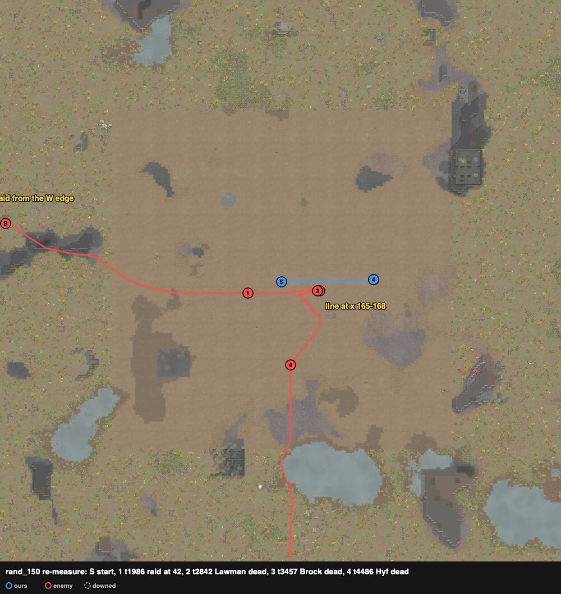

# rand_150 — Claude, 2026-10-06 (re-measure, ranged fire by `Keeper.assign`) — civil outlanders ×9 vs rough outlanders ×9 — repelled

Trace `results/human/traces/rand_150_claude_20261006-092317.jsonl.gz` · row `results/human/play.jsonl` ·
result: **repelled** (enemies_cleared t6203), **0 lost**, 0 downed, 0 permanent, HP 159% ·
raiders: Lawman, Meach, Brock, Kipper, Paul, Pavel, Hyf dead, Gwen downed; Fausto (rifle) left
south · **badness 6.4** (first play 36.4, agent `doctrine` 172.7).

## Why a re-measure
The first play (`rand_150_claude_20261005.md`) gave ranged orders with a stall rule: a new target
when "Shots fired" had not moved for 3 steps.
- It ran before the mod's wait setting changed (2026-10-05 evening, commit 56e7242). So a step
  was ~30 ticks and the stall rule ~90 ticks.
- Lover's bolt-action has aim 102 ticks + cooldown 90. Its target changed at least 27 times in
  the trace's polls.
- The stall rule dropped Lawman for the nearest raider, and the priority rule sent Lover back.
  The swaps were Lawman ↔ Paul (15), Meach (6), Brock (4) and Kipper (2).
- Lover fired 5 shots in the whole fight.

A switch restarts the aim (`results/audit_attack_orders.md`, dummy test). This run keeps the plan
and changes the ranged micro.

## Card at the start
The same as the first play (sides, loadout, line).

Kept the same:
- **Loadout:** Lilu's rifle → Lover (12); Lilu ← the good shotgun (done by t37).
- **Line:** two rows, drafted at t60, waiting until a raider was within 42 (t1986; the first play's
  check fired at t2040 with the raid at 39).
  - Front at x 165: Molina z118, Queen 121, Axle 124, Nytro 127, Vladimir 130.
  - Back at x 168: Lilu 121, Lover 124, Ash 127, Kanze 130.

Changed:
- **Ranged targets** come from `hands.Keeper.assign` (scratchpad `duel150a.py`).
  - Each shooter's value of a raider: expected damage at that distance × cover (1.0 on this
    cleared square) × weight × (1 − friendly-fire risk) / (1 + shooters already on it).
  - Weights: Hyf 1.5, Lawman 1.5, Fausto 1.2, the same for every shooter. The first play's
    priority lists were per shooter: Lover → Hyf, Lawman, Fausto; Axle → Lawman, Gwen.
  - One order per target, kept. A switch to a better raider needs 1.25× the current value, at
    most once per weapon cycle. A target that falls, leaves range or is marked bad is replaced
    at once.
  - A shooter with nothing worth shooting holds fire.
- **Knives:** Ash and Kanze go for the nearest raider within 7 once one is within 2 of the squad,
  for the whole fight. The first play started at 2 (reach 8) and widened it to 6 (reach 7) at
  t3064. No raider came within 2 here (closest: Brock, 3.2).
- **Control step:** ~6–7 ticks here against ~30 in the first play (the wait-setting change). Every
  order, the knives' included, could come about 4× sooner. This difference was not planned.

## Scenes
### t1986–2304 `approach` → `skirmish-line`
- **saw:** the pistols (Kipper, Paul, Lawman) came first along z 118–121. Gwen and Meach were
  8–10 cells behind them, Brock 12–13; the rifles and Pavel further back.
- **followed:**
  - Every shooter held fire until a raider was in its own reach.
  - Lover (range 37) first took Kipper at 36.5 from his own spot (t2114; 33 from the front row),
    then Lawman (t2304, weight 1.5).
  - The revolvers and pistols took raiders as they came within 26.
  - Kipper was hit to 76% by t2268.

### t2304–2842 `raid-holds` (16–22 cells)
- **saw:** the pistols held at 16–22 cells; Meach and Brock (knives) kept walking in.
- **followed:**
  - Lover was on Lawman from t2304 to his death.
  - Nytro (t2323–2489) and Axle (t2349–2464) were on Lawman only for a while. The spread term
    moved them to Gwen and Meach. All three were on him together for ~115 ticks (t2349–2458).
  - Lawman went 100 → 84% by t2458 and → 49% by t2535, with only Lover on him from t2489.
    **Lawman dead t2842.** In the first play he lived past t5224.
  - The rest spread: Queen → Kipper, Molina → Paul, then Brock.
  - Ours hit: Axle 60%, Lover 51% by t2876, Ash and Queen 84–87%.

### t2939–3457 `raid-holds` (the knives walked in; shot 3–6 cells out, no contact)
- **Meach dead t2939**: shot at 6 cells; Nytro and both shotguns (Vladimir, Lilu) on him at the end.
- **Gwen down t3375** (machine pistol).
- **Brock dead t3457**: he reached 3 cells (3.2 from Molina at t3427, "melee attacking Molina").
  Four shooters were on him at the end: Molina, Vladimir, Nytro, Lilu.
- Our knives never went out: no raider came within 2 of the squad.
- In the first play both raider knives reached the front (Meach t2913, Brock t2942). Only Ash went
  at them: Brock from t2942 (in contact t3064), then Meach from t3260. Kanze stayed on the back
  row.

### t3457–3859 `raid-holds` → shooters spread over the last three
- Pavel (shotgun) came to 13 cells (t3469) and held there; Kipper held at 14, Paul at 18.
- **Kipper dead t3748, Paul dead t3859.** The raid fled the same tick (`raid_fled_tick` 3859).
- Nytro was hit to 59%.

### t3859–6203 `raid-breaking`
- Pavel and Hyf turned east toward the map's east edge.
- **Pavel** walked in from 13 to 9 cells and **died at (156,121), ~t3972**.
  - The last poll with him alive is t3945.
  - His health read 100% in the controller's lines to the end, though six shooters were on him.
- **Hyf** (rifle) walked east along z 121 (`targeting cell (249,121)`).
  - He stopped at (155,121), 10 cells from the front row.
  - Every shooter took him there (Lilu from t4429): **Hyf dead t4486**.
- Fausto walked off south; enemies cleared t6203.
- No rush was ordered. In the first play, the rush on Paul at t4939 was a separate hand order;
  Ash died in it.

## What the play stood on (observed)
- Per pawn, shots fired / damage dealt (first play → this run):

  | pawn | weapon | first play | this run |
  |---|---|---|---|
  | Lover | bolt-action | 5 / 53 | **12 / 134** |
  | Axle | revolver | 25 / 53 | 19 / 82 |
  | Queen | revolver | 25 / 140 | 18 / 100 |
  | Molina | autopistol | 35 / 30 | 25 / 62 |
  | Nytro | autopistol | 27 shots (died) | 25 / 53 |
  | Vladimir | shotgun | 7 / 57 | 10 / 46 |
  | Lilu | shotgun | 8 / 72 | 5 / 59 |

  - Shots: 132 → 114.
  - Damage dealt: ≥405 → 536. In the first play, Nytro's damage was not read and Ash (dead,
    melee) was not counted. Our knives never fought here.
- Lawman, the raid's best pistol (shooting 8), died at t2842 with Lover's kept order on him. That
  was before either raider knife reached the line.
- None of ours went down. The raid's knives and shotgun died 3–9 cells out (Brock 3, Meach 6,
  Pavel 9), not at the line.
- One run is one draw (README, Variance). Besides the ordering, the control step (~4× shorter)
  and the knives' rule differed from the first play, and so did the dice.

## New tags / sites (for the user to look at)
None.
