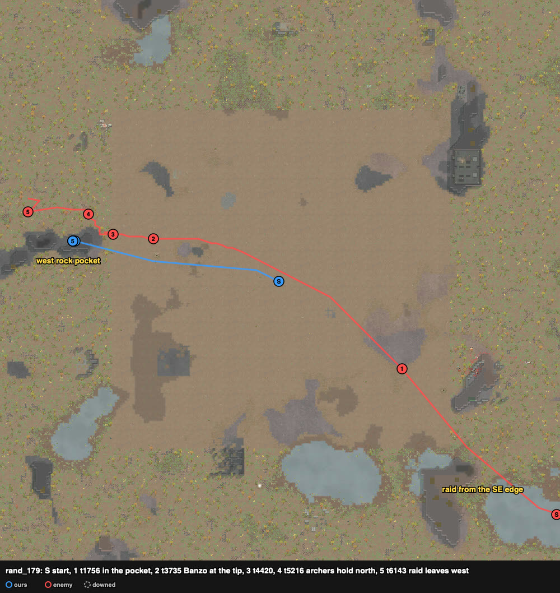

# rand_179 — Claude, 2026-10-05 (played alone) — pirate guns ×8 vs tribal archers ×9 — repelled

Trace `results/human/traces/rand_179_claude_20261005-165233.jsonl.gz` · row `results/human/play.jsonl` ·
result: **repelled** (enemies_cleared t6860), **1 dead** (Takashi), 0 downed, HP 146% ·
raiders: Bole, Gubibar, Crouca, Shark, Dove dead, Banzo downed; Goose, Ape, Quegu left west ·
**badness 15.8** (agent `doctrine` 132.0: 9 lost). Sheet: `sheets/rand_179_start.md`
(`tools/cases.py similar`: no close card; used rand_084, rand_058, rand_126).

## Card at the start
8 Pirates, low skill: Missy 6 molotovs, Thorn 6 smoke launcher, Villa 4 bolt-action rifle,
Ward 4/5 revolver (the raid's target), Parsnip 1 revolver, Philip 2 machine pistol, Sosa 0/2
autopistol (Tough, helmet), Takashi 0/4 steel mace. Raid: 9 TribeRough from the SE edge
(245–249, 11–25), ~125 cells: recurve bows Quegu (8/11), Banzo (6, Jogger), Gubibar (5), Goose
(4), Dove (1), short bow Ape (5); ikwas Shark (11/7), Bole (4/7); club Crouca.

## Scenes
- **t0–105** `loadout`: rifle Villa → Missy (6), molotovs Missy → Villa.
- **t105–1756**: walked ~95 W into the west rock pocket's east part (29–35 × 140–142). Cells:
  Ward (35, 142), Takashi (34, 142), Sosa (33, 142), Villa (32, 142), Philip (33, 141), Parsnip
  (32, 141), Missy (31, 141), Thorn (30, 141).
- **t2701–3735** `raid-strung-out`: the raid followed our route west along z 142–145, straight
  at the pocket's east side (rock B). Banzo (Jogger) ~20 cells ahead of the body.
- **t3735–4420** `corner-ambush`: they came over rock B's north tip one or two at a time, at 1–3
  cells: pistols at point-blank and Takashi's mace. **Banzo down t3913; Bole dead t4135;
  Gubibar t4302; Crouca t4420.** Takashi (53%) was killed at the tip (t4450).
- **t4571–5021** `molotov-into-group`: Goose and Shark together at the tip, 6 cells out:
  Villa's molotov; **Shark dead t5021** (in the pocket, at 1 cell).
- **t5081–5680** `raid-holds`: Goose, Quegu, Dove, Ape stood 11–16 cells north of the pocket
  (37–44, 149–159), out of sight both ways; Thorn's smoke on Goose and Dove. **Dove dead
  t5680.**
- **t5680–6860** `raid-breaking`: the last three walked off west ("targeting cell (0, 149–159)").

## What the play stood on (observed)
- Rock B kept the archers from shooting into the pocket; they had to come over the tip, inside
  our pistols' range, one or two at a time.
- Damage dealt: Villa (molotovs) 287, Sosa 120, Ward 108, Philip 102 (42 shots), Missy (rifle) 97.
- The archers who held north never got sight of us and left after five of their side died.
