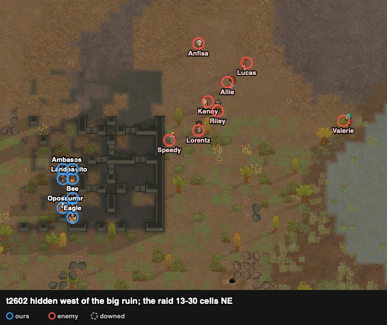
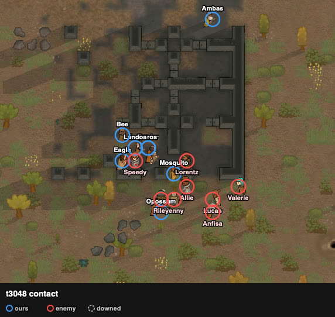
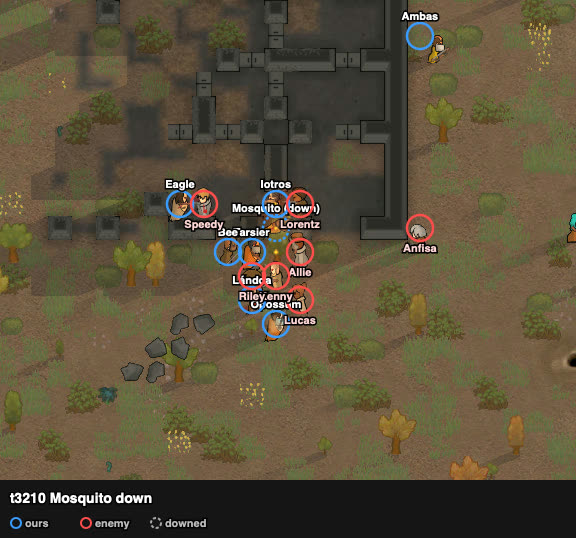

# rand_190 — Claude, 2026-10-05 evening (after the user's two attempts)

Trace `results/human/traces/rand_190_claude_20261005-203523.jsonl.gz` · row `results/human/play.jsonl`
(player `claude`) · result: **defeat, raid left with 6 captives** (t6724): **1 dead** (Ambas),
**6 kidnapped** (Opossum, Iotros, Tarsier, Bee, Mosquito, Lándoa), Eagle downed and left; one
raider dead (Speedy) · HP 766% · **badness 173.6**. The user's attempts: 129.9 and 172.0; the
agent: 192.0. Start sheet `sheets/rand_190_start.md`.

## Card at the start
Same as the card. Loadout: pilas to Eagle and Tarsier (the user's reading: the pila's melee damage
is higher than a bow's), bows to Mosquito and Lándoa.

## Scenes

### t0–2251 `raid-far` → `loadout`, walk
The squad walked ~88 cells to the big ruin's west wall and waited on the 8 cells with the fewest
far eastern viewers (98–99, 39–44).

### t2251–2783 `concealed-wait`
- The raid came at the ruin as one bunch: 13–30 cells at t2602, all targeting Eagle. Only Valerie
  trailed, by ~10 cells; it was not strung out as in the user's attempt 1.
- **t2771 Speedy saw us at 10 cells**, as computed. Exposed walk 83 → 82 → 91: **go t2783**.
- The stagger by hidden steps sent the movers out in this order:

| ticks | movers |
|---|---|
| t2783 | Mosquito → Allie |
| t2800 | Ambas → Valerie (round the ruin's north side) |
| t2919 | Eagle |
| t2936 | Opossum, Iotros |
| t2953 | Tarsier |
| t2970 | Bee, Lándoa |

### t2783–3210 `melee-contact` → `mark-shooters`
- The raid closed on us while the core still waited for its release.
- Speedy reached Eagle and held him in melee, so Eagle never went for Kenny.
- Riley's molotov hit our cluster (t3068, at (102, 36)).
- **t3174 Mosquito down** (to Allie): the first mover, alone.
- By t3210 everyone stood 1–3 cells from the raid's body. Kenny, Allie, Riley, Lorentz and
  Anfisa were all within 1–6 cells.

### t3210–3419: the locks did not lock
- Kenny, Allie and Riley kept "watching for targets", shooting point blank, with our pawns
  adjacent and on "melee attacking" jobs. Anfisa (shotgun) was unmarked at 6 cells.
- Records at t3419: damage dealt Bee **0**, Lándoa **0**, Tarsier 13, Opossum 42, Eagle 52 (the
  bow-holders on melee jobs dealt nothing).

### t3419–4112 → `gang-melee` (changed: melee weapons gang one at a time, bows shoot)
- Controller `focus190.py`: Eagle, Opossum and Tarsier finish the raider each is on, then gang
  the weakest-in-melee shooter. Bows fire at the most dangerous raider not in melee with one of
  ours.
- **t3490 Speedy dead** (Eagle). Kenny 100 → 68% (Tarsier).
- Downed: **Iotros t3582, Lándoa t3678, Tarsier t3739, Opossum t3853, Eagle t3889, Bee t4037**.
- **Ambas shot dead t4111**, alone near Valerie. Squad down at t4112.
- Six raiders stood at 46–100%.

### t4112–6724 `kidnap`
Six of ours carried off (t5287–6262). Eagle was left.

## What the play stood on (observed)
- **The site hid the squad as computed** (first sight at 10 cells). But the raid came as one body
  (the walk to it was ~150 steps, shorter than to the west sites), so contact was with all eight
  at once.
- **The stagger made the start piecemeal:**
  - The hidden-step differences were up to 11 steps × 17 ticks. The two with the longest hidden
    routes went first and alone; the core waited up to 187 ticks.
  - Mosquito, the first out, was the first down.
- **Adjacent bow-holders did not stop the gunners shooting.**
  - Kenny, Allie and Riley shot point blank while Bee, Lándoa and Tarsier stood next to them on
    melee jobs.
  - In the user's attempt 1, bow-holders did draw melee: Riley on Tarsier, Allie on Bee, Valerie
    on Ambas. This run shows that an adjacent pawn alone is not a lock.
- Only two weapons did real melee damage (pila, ikwa). Against eight raiders in a body, at 1–6
  cells, the squad lost seven pawns in ~950 ticks.

## Operating facts
- `get_pawn tab=records` gives "Damage dealt" per pawn: the check on whether a melee job lands
  (like "Shots fired" for shooters).
