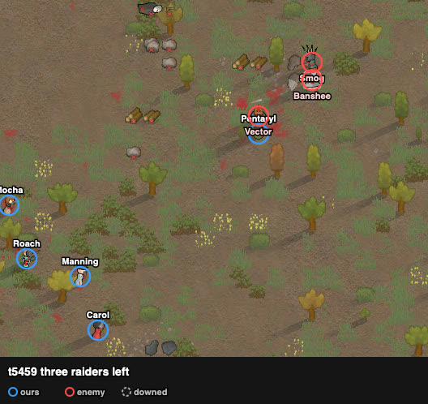

# rand_227 — Claude, 2026-10-05 evening

Trace `results/human/traces/rand_227_claude_20261005-204801.jsonl.gz` · row `results/human/play.jsonl`
(player `claude`) · result: **repelled (enemies cleared t8055)**: 0 lost, Fernanda downed,
1 permanent injury, HP 359%; seven raiders dead, Banshee left · **badness 19.4** (agent `doctrine`
173.5). Start sheet `sheets/rand_227_start.md`. Controller: scratchpad `gun227.py`, made from
rand_150's line controller; knives lock raiders within 7 once one is within 6.

## Scenes

### t0–500 `us-skill-mismatch` → `loadout`, `skirmish-line`
- Mocha (12) took Barr's good autopistol, Cowan (10) Fernanda's, Manning (6) Pentaryl's.
- Line across the raid's approach, ~3 cells apart, from (112, 121) to (124, 111). Barr, Fernanda
  and Pentaryl (knives) stood 2 cells behind.

### t1880–2830 `raid-strung-out` `raid-holds`
- At 40 cells the raid was strung out: Lynx first; Diver, Linaly and Smog 5–10 behind; Banshee
  and Hexad ~100 cells back.
- Lynx stopped at 23 cells and Diver at 27. The clubs came on.

### t2830–4290 `melee-contact` → `melee-lock`
- Linaly (club, 7) and Vera reached the line and were locked (Barr, Pentaryl, Fernanda, Roach).
- **t3248 Lynx shot dead** at 23 cells. **t3310 Fernanda down.**
- Linaly died at t3466, Vera at t4232; Hexad (knife) came last and died at t4292.

### t4290–5494 `raid-holds` → `close-in`
- Diver, Smog, Banshee and Vector held at 20–27 cells. "Fire at" was disabled for them (out of
  range), so the shooters kept firing on the raider in melee: four guns on Vera, 22 → 16%.
- The line stepped 6 cells NE. Barr went at Diver and Pentaryl at Banshee.
- **t5116 Diver dead** (locked by Barr, shot). **t5494 Vector dead.**

### t5494–8055 `raid-breaking`
- The shooters' hits on Banshee and Smog landed only once they stood within ~15 (62–64%).
- Both backed off east. Barr followed Smog and killed him (~t7039); Banshee left by the east edge.

## What the play stood on (observed)
- Guns in the hands of the 10–12 shooters (three had held knives).
- The raid strung out over ~100 cells from the NE corner, so its melee pawns arrived one or two
  at a time.
- Holders at 1–2 cells beyond our range were safe from the line until it moved. Check "Fire at"
  being disabled (out of range) when the shooters sit on a target that is not the priority.

## Re-measure 1 (2026-10-06): the same plan with attack orders kept (hands.Keeper) — defeat, 73.8

Trace `results/human/traces/rand_227_claude_20261006-070654.jsonl.gz` · row `results/human/play.jsonl`
(player `claude`, second rand_227 row) · result: **squad down, defeat**: Mocha dead, 8 downed;
five raiders dead (Lynx, Vera, Hexad, Linaly, Diver) · **badness 73.8** (attempt 1: 19.4).

Why re-measured: the audit (`results/audit_attack_orders.md`) found attempt 1's controller
switching targets constantly: 665 switches in 679 attack runs, median run 8 ticks. Controller:
scratchpad `gun227k.py`.
- **Kept from attempt 1:** the same loadout, the same line, the same priorities (Lynx/Diver
  first for Mocha, Cowan and Diana; the rifles once Lynx fell), knives locking arrivals, and a
  close-in when no shooter has a target.
- **Changed:** the orders go through `hands.Keeper`. An order is given once and kept while the
  job names the target. It is given again only when the order ended, and the target changes only
  when it falls, when shots stop for 3 weapon cycles, or when a priority raider comes into reach.
- A first try with an earlier Keeper was stopped at ~t4600 and not counted. That Keeper did not
  read the job (review: `wf review-hands-keeper`); no row was written.

### Scenes
- **t1880–3036:** the raid came strung out as before. Lynx stopped at 21–23 cells, near the
  autopistols' range edge, and five shooters kept him as their target. Linaly, Vera and Hexad
  walked into the knives.
- **t3036–4280:**
  - The shooters stayed on Lynx while the clubs and Hexad fought the knives 1–4 cells from the
    line. In-melee raiders were ranked last, and nothing re-ranked them.
  - Carol (t3335), Manning (t3693), Barr (t3723), Pentaryl (t3987) and Fernanda (t4240) went
    down.
  - Lynx died only at t4280 (attempt 1: t3248). Vera (t3440), Hexad (t4328) and Linaly (t4468)
    died after him.
- **t4468–5482:** the rifles held at 24–28 cells. Mocha's job kept "attacking Vector", so the
  close-in rule never fired; the line was moved by hand at t5482.
- **t5482–7891:** Roach and Diana went down on the way in, and Diver died (t6503). Cowan went down
  (t7130), and Mocha died (t7891).

### What the play stood on (observed)
- Ranged attack runs: 16 (median 834 ticks, 8 switches), against attempt 1's 679 (median 8 ticks,
  665 switches). The switching was gone.
- What attempt 1's switching had also done was put shots on the raiders closest to the line. Kept
  on the priority raider at the edge of range, the shooters left the melee arrivals to the knives.
- One run each: the two results are single draws.
