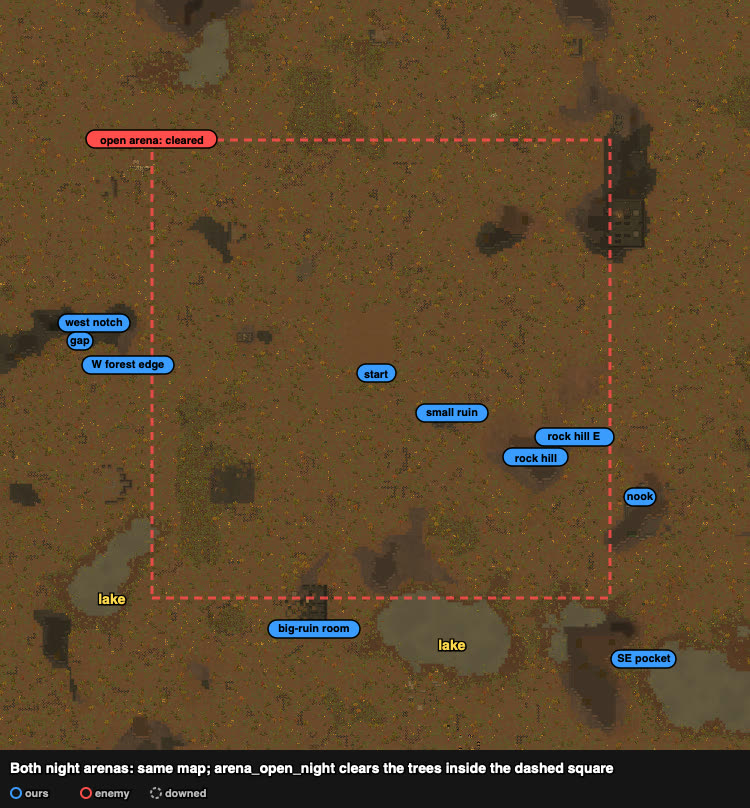

# Sites on the night arenas

Sight blockers are only rock (`%`) and walls (`#`) in `rca.terrain` (trees are cover, not
blockers). Both night arenas are one map: `arena_open_night` is `arena_forest_night` with the trees cleared
inside x 50–203, z 50–203 (the dashed square). Rock, ruins and lakes outside that square are
the same on both, so a site found there in one problem is a candidate in every other. Inside it
the open arena has no walls either: the small ruin (144–153, 108–116) is not there (checked on
rand_190's map, 2026-10-05). Our squad always starts at
(125, 125); the raid walks in from a random edge.

Walking pace seen (drafted squad): 16–18 ticks per cell in the open, ~30 through forest
(rand_084: 95 cells in ~2900 ticks). First contact came at t2000–3500 in every case below.

| site | cells | what is there | from start | used in |
|---|---|---|---|---|
| **nook** | inside (212–214, 81–87); mouth (211, 84) | a pocket between an ancient ruin's wall and rock, open only to the north-west; a marble wall closes it (break it: ~1100 ticks with 6 pawns hitting; 6 rounds of 9 pawns at a 90-tick cadence in rand_118); an urn at (212, 85) beside the mouth (its cell can be stood on once broken; left standing, only (212, 83) and (212, 84) touch the mouth from inside); a column at (214, 84); only (212–214, 84) see far down the lane west (z 84–85); the south part (209–212, 78–82) is out of the lane's sight | 97 E-SE | rand_127 (human, Claude), rand_118 (Claude) |
| **rock hill** | hill ~(170–185, 89–106) | dark ground, **not rock** (no `%` cells in `rca.terrain`): on the forest arena the trees around it hid the squad; on the open arena (inside the cleared square) it hides nothing | 55 E | rand_030, rand_039 (forest) |
| rock hill E | (184–201, 95–120) | waiting spot on the far side of the hill from a south/west raid | 69 E | rand_030 (human, Claude) |
| rock hill E side, low | (187–191, 95–97) | last bound of a withdrawal east | 66 E | rand_039 (Claude) |
| **small ruin** (forest arena only) | (144–153, 108–116) | low ruin walls, near the start; ten pawns packed at (145–150, 108–111) waited hidden there while a raid from the SW came in strung out | 28 E-SE | rand_039 (human, Claude), rand_023 (human, won) |
| **west notch** | (29–32, 141–143) | a notch in the west rock mass, blocked on three sides | 96 W | rand_084 (human, Claude) |
| gap | (26–28, 136–140) | a gap through the west rock to its south face (31–34, 135–137) | 98 W | rand_084: slip through it to cut the throwers' sight |
| **west rock pocket** (same place, cell map from `rca.terrain`) | pocket x 25–35, z 140–144 between rock A (13–24, 139–145) and rock B (27–40, 138–145); open to the north; gap to the south-west at (23–26, 139) | seen from the east, B hides the pocket: raiders coming along z 143 round B's north tip (37–40, 145) and are then 4–6 cells away; a corner ambush for melee. Raiders who go north of it (z 150–159) see into the pocket | 96 W | rand_015 (Claude, lost ×2), rand_126 (Claude, won), rand_058 (Claude, won), rand_018 (Claude, lost), rand_179 (Claude, won vs archers) |
| **NE ridge + walled hall** | rock ridge x 196–220, z 165–222; a walled hall (walls 202–214 × 167–183, inside 203–213 × 168–182) set against it | **no door**: all 165 inner cells hidden from outside. Break one wall cell (granite) to make a one-cell mouth: at (213, 167) a 32-cell block (203–211 × 168–172) stays hidden from every outside cell within 35 (LOS calc, untested in play) | 95 NE | rand_023 (breach failed); rand_164 (human, won: the three spears broke one cell of the east wall, (214, 177), in ~1100 ticks while a bait drew three raiders away; the three best melee pawns took the inside cells (213, 176–178), and when Bacchus (the middle one) went down the next best took his cell. The player thought that in this scenario the south wall would have done better, as it would likely have kept the bait's way back in open); rand_164 (Claude attempt 2, won: the south wall cell (209, 167), outside cells (208–210, 166) open, rock at 200–207; attack orders started nothing after 451/510 and the cell was deconstructed in ~675 ticks; the three spears at (208–210, 168) hit each raider in the breach, and all three kills came from the two side cells, diagonally across the wall corner) |
| **big-ruin room** | squad waited at (100–106, 39–41); ruin ~(98–110, 38–58) | walled rooms south-west of the start | 88 SSW | rand_065 (human) |
| **big-ruin room R2** | inside (104–107, 46–47), 8 cells; doors N (105, 48), W (103, 46), inner S (106, 45) from R1 (104–107, 43–44), which has a W door (103, 44), a S door (106, 42) and a gap (105, 42) | three one-cell doors, no breach needed; every inside cell touches a door except (107, 47); closed doors block sight, so throws from inside go only through an open door; a closed room keeps tox gas thick | 82 S-SW | rand_115 (Claude ×2), rand_012 (Claude: won; a corpse in a doorway keeps the door open), rand_018 (Claude, R1+R2: lost), rand_190 (human attempt 2, R1+R2: lost to two molotovs at R2's north door and gunners 1–4 cells outside it, a shotgun among them) |
| big ruin, outside its west wall | waiting cells (98–99, 39–44) | the ruin hides them from the east and north-east: on the shortest path from an east-edge raid (247, 145–155) the first cell that sees them is (108, 37), 9.8 cells off, round the ruin's south-east corner (`rca.terrain`); grass around (outside the cleared square) | 88 SSW | rand_190 (Claude: the raid first saw the squad at 10 cells as computed, but came as one body; lost) |
| W forest edge | (35–51, 118–137) | the treeline west of the cleared square (open arena only: on the forest arena it is just forest) | 83 W | rand_107 (human) |
| **west wall ruin** | wall x 39–43, z 82–94 (north–south, broken), doors (40, 84) and (40, 92); squad cells west of it (34–38, 79–94) | a ruin wall on the open arena's west grass strip, facing east; open at both ends (the raid came round the north end, Riley at (33, 93)); a lake south-east (42–55, 75–79). The grass strip burns: a molotov grew a 75-cell fire there | 90 W | rand_190 (human, lost) |
| SE pocket | (212–216, 28–40) | south-east, by the lake and ruins near the edge | 130 SE | rand_067 (human, end of a kite) |

## Base arenas (PROCEDURES §1c)

Each base is its own map; our squad starts in a different place on each.

| site | cells | what is there | from start | used in |
|---|---|---|---|---|
| **Ithfunda east room** | room x 129–137, z 188–196; door (133, 187); corridor x 133, z 179–186; nook (126–133, 175–181) | a room cut in the rock, a dead end (the rooms behind it, to z 227, open only into it through doors at (133, 197), (133, 207) and an opening at (133, 218)); its one door is at the top of a 1-wide, 8-cell corridor from the nook off the yard. Only (133, 188) is a cell a raider in the doorway can step to straight, but John stepped diagonally from the doorway onto (132, 188) past the rock at (132, 187) while (133, 188) was held. Guns on (133, 189–191) see down the corridor; cells off that axis see only the doorway. A torch lamp stands on (133, 192), a royal bed on (136, 190). In v2 (save map) still standing: a dresser on (135–136, 188), the royal bed on (135–136, 189–190), an end table on (135, 191), drapes on (135–136, 192) and the torch lamp; the door (133, 187) is saved closed | ~33 NE of the yard (113–120, 162–166) in a straight line; all inside ~900 ticks after the start; 42–43 steps from the v2 squads' starts | base_ith_pirate_2x, base_ith_tribe_2x (Claude); every base2_ith_* problem in the turtle_at plan base2_r1 |
| **Monler R2** | room x 141–149, z 75–83; door (145, 84); corridor z 85 (x 131–166; a wall at x 130, rock from x 167); passage x 145 (z 87–91, 1 wide; a darktorch on (145, 88)) from a small hall x 145–149, z 92–93 (a table on (148, 92–93)) behind the outer door (145, 94), through the inner door (145, 86) | the base's rooms are a grid of 9×9 rooms behind the E–W corridor z 85, all doors closed but the passage's inner door; with the outer door, the inner door and R2's door held open, the only open way in is the straight 1-wide passage x 145 ending at R2's door. R2 was full of benches (a smelter on (141–143, 82–83), a smithy covering (146, 83), a machining table, a tailoring bench, shelves on (148–149, 82–83)): uninstalled, all eight fit within 3 cells of the door. Rest and the downed can go west into R1 through the closed door (140, 79). In the user's attempt raiders stood on (146, 93), (143, 93), (144, 91–92), (142, 94) (t7975–11283) and a fire burned on (147, 93). The v2 save map: (146, 93) is in the hall; (141–143, 92–93) is a separate area west of a wall at x 144, open to the north; (144, 91–92) is rock. In v2 R2 still holds comms consoles on (141–142, 79–81), tool cabinets on (144, 78–79) and (146, 78–79) and a darktorch on (145, 79); the inner door is saved held open, R2's door and the outer door closed | ~45 cells SE of the yard (119–129, 128–130) by path; 48–49 steps from the v2 squads' starts | base_mon_tribe_3x (the user; Claude, discarded); every base2_mon_* problem in the turtle_at plan base2_r1 |

Not a site but recorded: rand_029 (open) held a north–south line at x 138–144, z 107–148, east
of the start.

Coordinates come from the traces (squad cells when the raid first came within 15) and the
watcher records; reports (`results/human/reports/`) have close-up frames of each.
