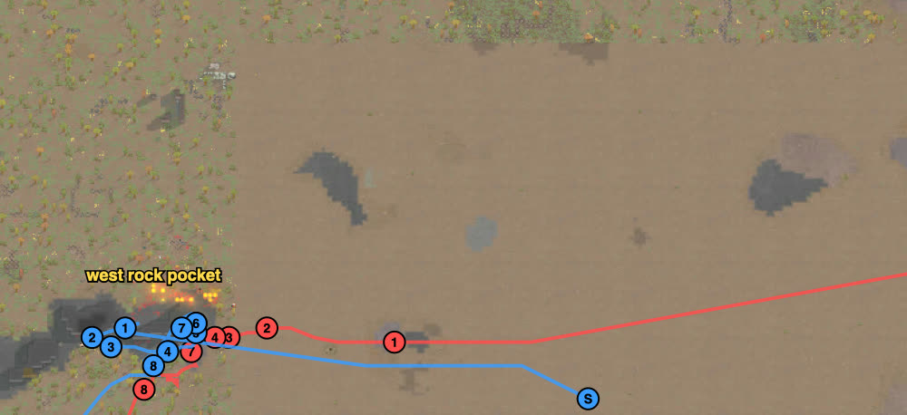
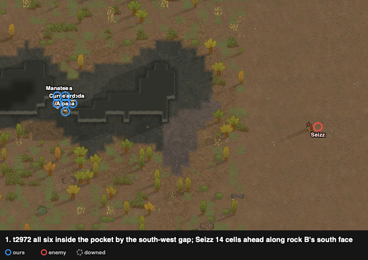
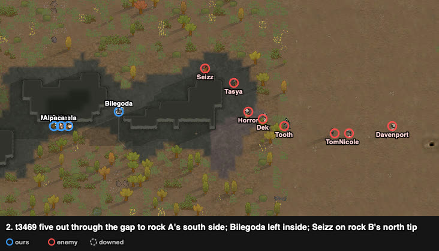
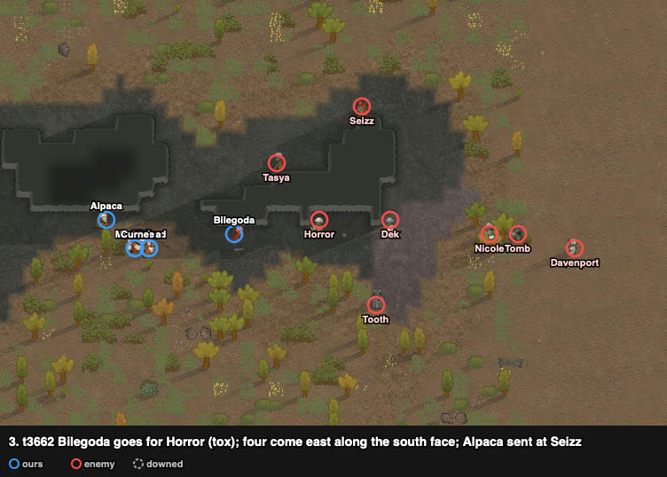
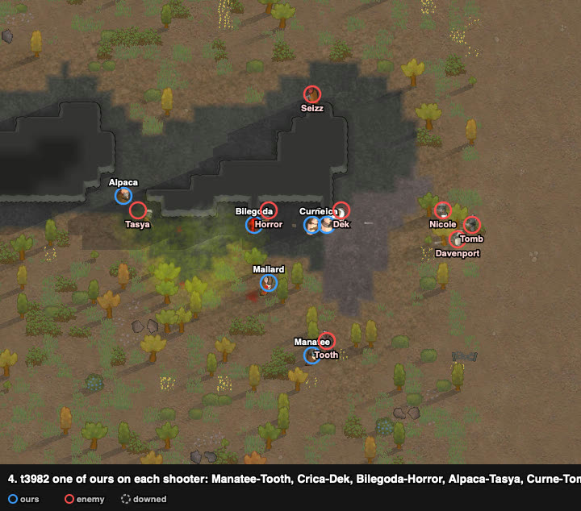
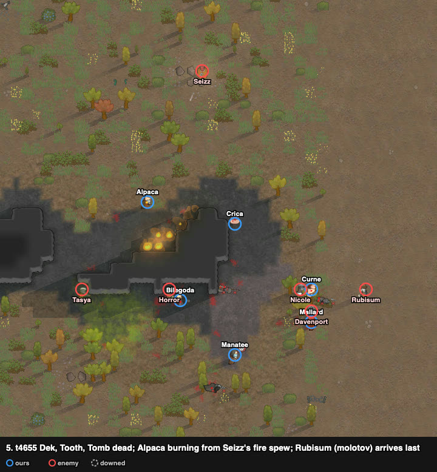
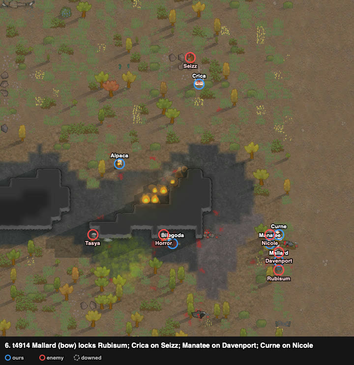
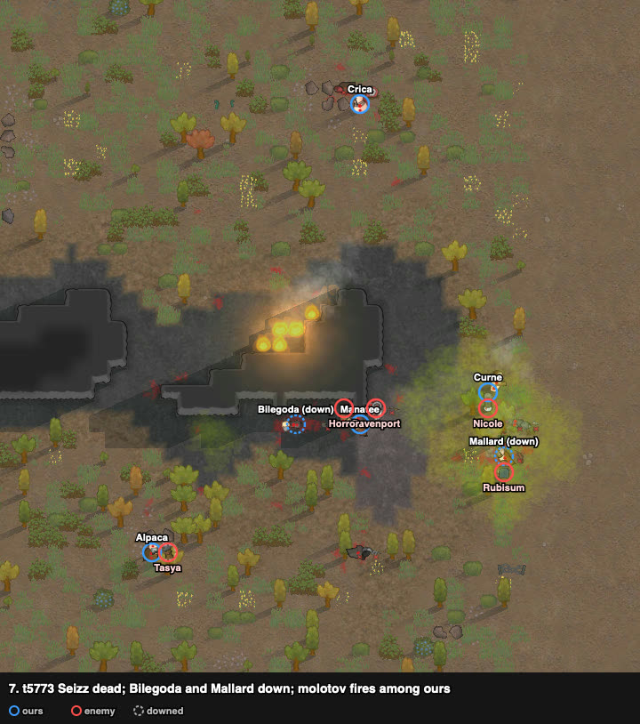
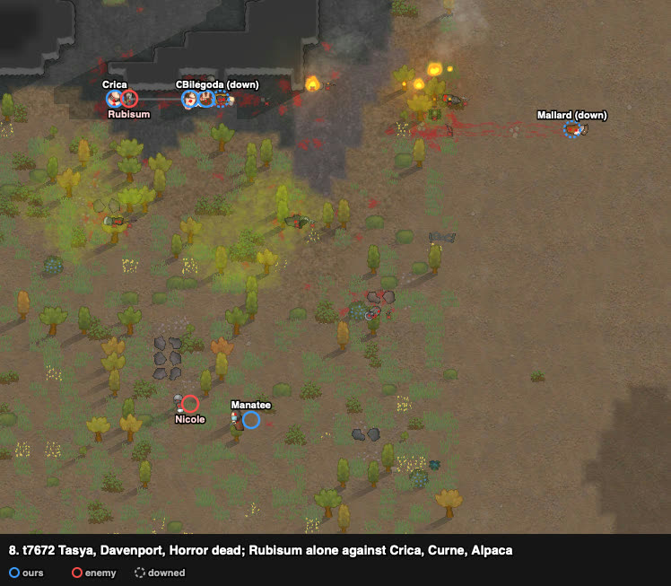
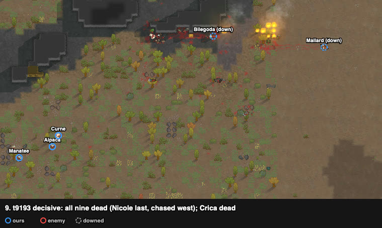

# rand_015: human + Claude's loadout vs agent (doctrine) and Claude ×3, Neanderthal melee vs Waster gunners

Worst-list #11. **Enemies cleared, decisive**: 1 of ours dead (Crica), 2 downed; all nine
raiders dead. The agent lost (3 dead, 2 kidnapped), and Claude lost all three attempts
(captives each time). The user played it after work, and Claude watched.

**Problem.** arena_open_night, Strive to Survive, 500 v 500 pt. Our squad starts at (125, 125);
the raid walks in from the north-east corner (243–249, 191–205), ~142 cells away.

| ours (6 Neanderthals) | shooting / melee | weapon after the loadout |
|---|---|---|
| Manatee | 4 / **11** | steel ikwa (normal, Alpaca's) |
| Crica | 6 / 9 | steel ikwa (poor, Bilegoda's) |
| Mallard | 3 / 7, Psychopath | greatbow |
| Curne | 0 / 3 | wooden club |
| Bilegoda | 0 / 1, Kind | steel knife (Crica's) |
| Alpaca | 0 / 0, Kind | steel ikwa (poor, Manatee's) |

Neanderthals: robust, reduced pain, strong melee damage. Raid (9 Wasters, tox-immune):
- **Seizz:** machine pistol, 0/11, with **Fire spew**.
- **Tooth:** machine pistol, 11/10.
- **Rubisum:** molotovs, 6/4.
- **Horror:** tox grenades, 1/2.
- Dek and Tasya (pump shotguns), Davenport (autopistol), Nicole and Tomb (revolvers).

## Result

| | human + loadout | Claude (best of 3) | agent (doctrine) |
|---|---|---|---|
| outcome | **enemies cleared, decisive** (t9030) | defeat, raid left with Bilegoda | defeat, raid left with 2 captives |
| lost | **1** (Crica) | 1 dead + 1 kidnapped | 3 dead + 2 kidnapped |
| downed at end | 2 (Bilegoda, Mallard) | 1 | 0 |
| raiders dead | **9 of 9** | 4 | 3 |
| HP lost (sum) | 429% | – | 581% |
| badness | **33.2** | 61.4 | 105.2 |

## The player's reading and intents (as told after the battle)

0. **The top threat was Seizz:** Fire spew plus good shooting. A plain melee dive would set the
   squad on fire and out of control, and the raid would shoot freely meanwhile. The next
   threat was the tox grenade: the raid was mostly Wasters, so the gas would buff them and
   blur our pawns' consciousness, lowering our fighting.
1. **Alpaca, our least useful pawn, was sent at Seizz on purpose**, to draw out the Fire spew
   and leave Alpaca burning and out of control, not the rest. Crica's later move on Seizz
   was improvised.
2. **Bows would add little**, so Mallard (greatbow) was used to melee-lock too.
3. **Manatee was expected to be our main damage dealer.** Ours were set to mark the raid's
   damage dealers in order of danger: one of ours on each.
4. The raid strung out, and the molotov thrower arrived late, so by luck it became one on one.

## Route

From the trace. The squad walked ~100 cells west to the west rock pocket and waited by its
south-west gap. Then it went out through the gap and back east along the rocks' south side,
to meet the raid as it came along rock B's south face (z 137).

## Timeline

All six inside the pocket's west part by the south-west gap (25–27, 139–141), against rock A.
The raid came west along z 137, south of rock B: Seizz alone in front, 14 cells ahead of
Tasya, Dek and Horror; Rubisum (molotovs) 100+ cells behind.

Five went out through the gap to rock A's south side (17–19, 138); Bilegoda stayed inside.
Seizz stopped on rock B's north tip (38, 146), looking into the pocket.

Bilegoda (knife, melee 1) went for Horror (tox) along the south face. The four came east
behind him, and Alpaca was sent at Seizz on the tip.

**One of ours on each shooter:**

| ours | locked on |
|---|---|
| Manatee | Tooth (the raid's best gun) |
| Crica | Dek |
| Bilegoda | Horror (tox; the green cloud around them) |
| Alpaca | Tasya |
| Curne | Tomb |
| Mallard (greatbow) | Nicole |

Locked raiders do not shoot. Nicole, Davenport and Tomb held 8–15 cells east until our pawns
reached them.

**Dek, Tooth and Tomb dead.** Seizz used Fire spew on Alpaca, who burned and wandered; Seizz
backed off north to (38, 158). Rubisum arrived last and Curne went to him.

**Mallard (bow, 35%) held Rubisum** so the molotovs could not be thrown. Crica went north
after Seizz; Manatee went on Davenport, Curne on Nicole; Bilegoda (31%) was still on Horror.

**Seizz dead** (Crica). Bilegoda down (t5349, next to Horror) and Mallard down beside
Rubisum. Molotov fires among ours: Manatee and Curne burned and wandered for a while.

**Tasya, Davenport and Horror dead.** Our four standing were at 17–41%. Rubisum (40%) was
alone against Crica (17%), Curne and Alpaca.

**Rubisum dead; Crica dead** in that fight. Nicole, the last raider, walked west and was
caught by Manatee, Alpaca and Curne at (3–10, 115–119): **all nine raiders dead, t9030.**

## What it showed (observations)

1. **Every shooter was marked at once** (six locks at t3982), and the raid got almost no free
   fire. Claude's attempts waited in the pocket for the raid to come to rock B's tip. There
   the gunners who held north of the pocket (Tooth, 15–20 cells) shot ours, and the tip fights
   drifted into their view.
2. **A cheap pawn drew the Fire spew** (Alpaca): it burned one of ours, not the group.
3. **The throwers were held in melee**: Horror by Bilegoda (melee 1) from the start and
   Rubisum by Mallard (bow) when he arrived last. The tox cloud stayed around Bilegoda and Horror.
4. **One on one, the Neanderthals won**: Manatee (melee 11) killed Tooth (melee 10), and the
   others ground the raiders down over ~4000 ticks while ours fell to 17–44%.
5. No kidnapping: the raid never broke and never left, and its last pawn was hunted down.

## Data

- row: `results/human/play.jsonl` (rand_015, player `human`); agent row: `results/night/router.jsonl`
- trace: `../traces/rand_015_human_20261005-181831.jsonl.gz`
- watcher records (`tools/watch.py`): `../raw/rand_015/`; frames: `../raw/build_reports.py`
- case card: `results/cases/cards/rand_015.md`; Claude's attempts: `results/cases/journals/rand_015_claude_20261005.md`
