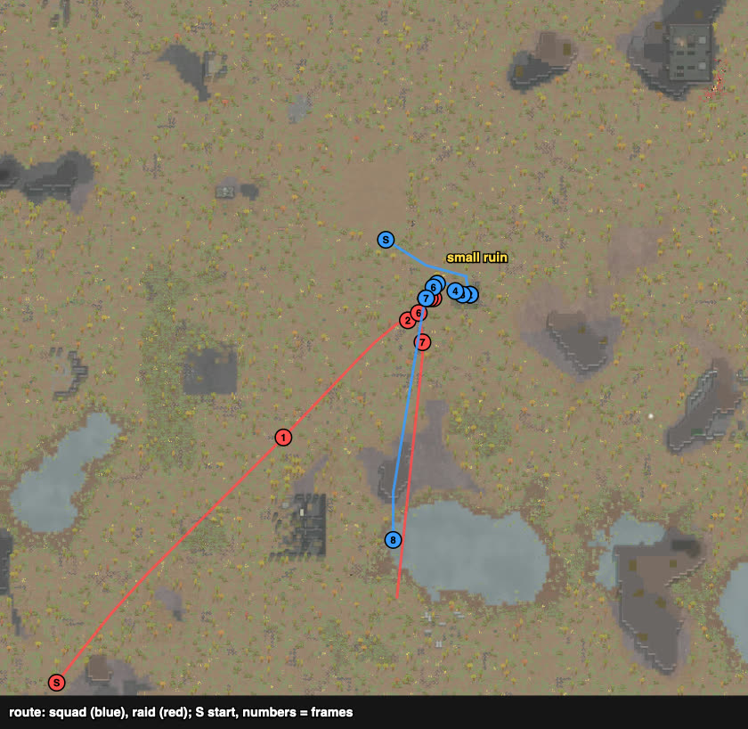
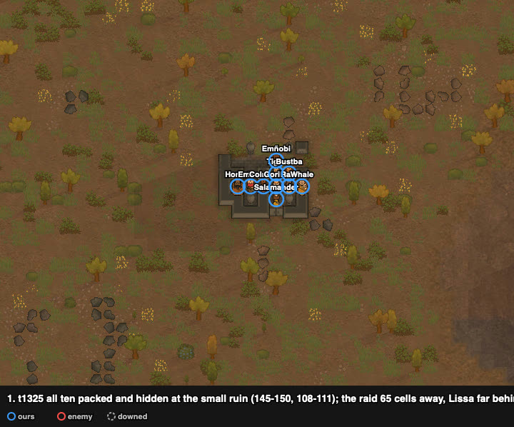
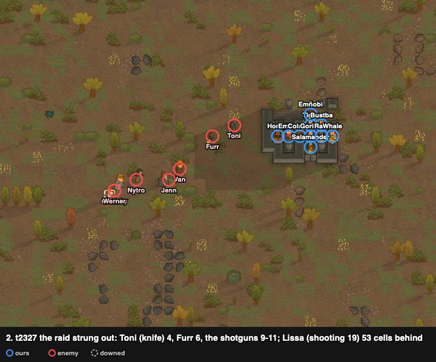
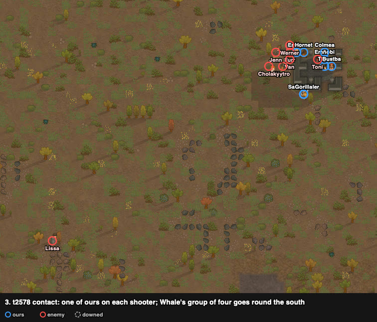
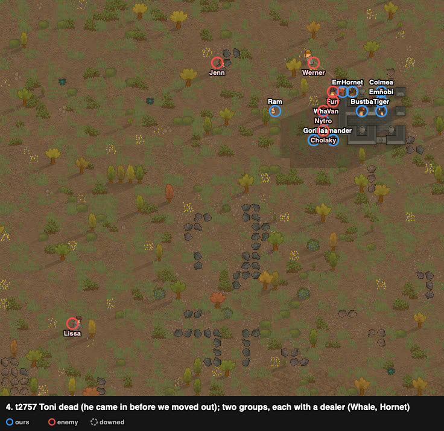
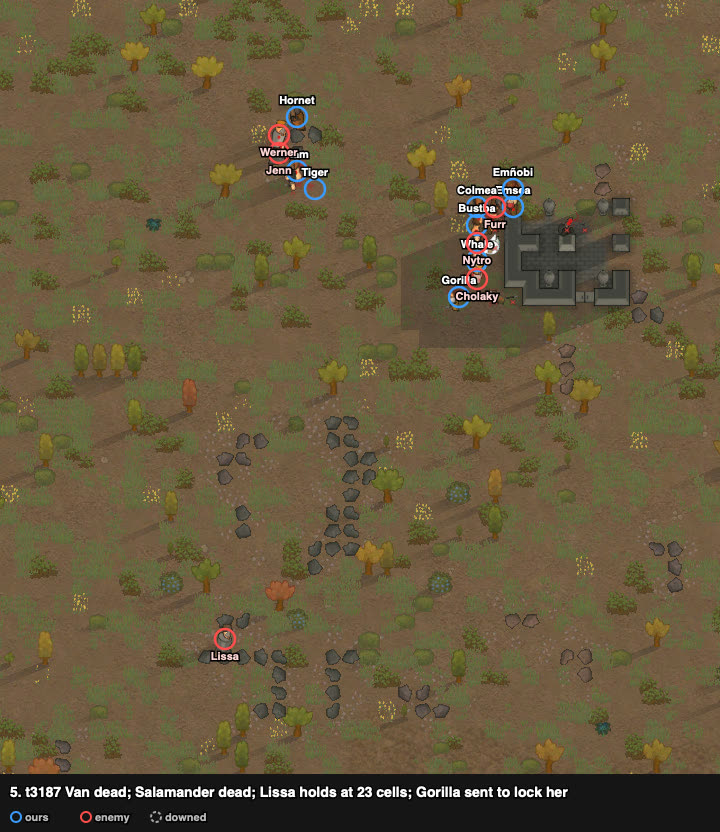
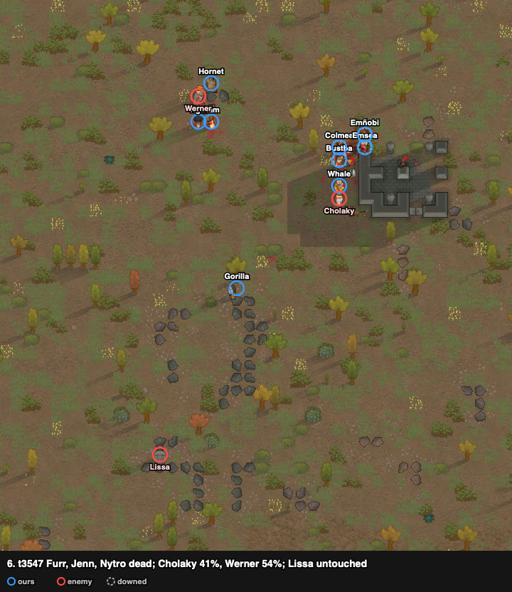
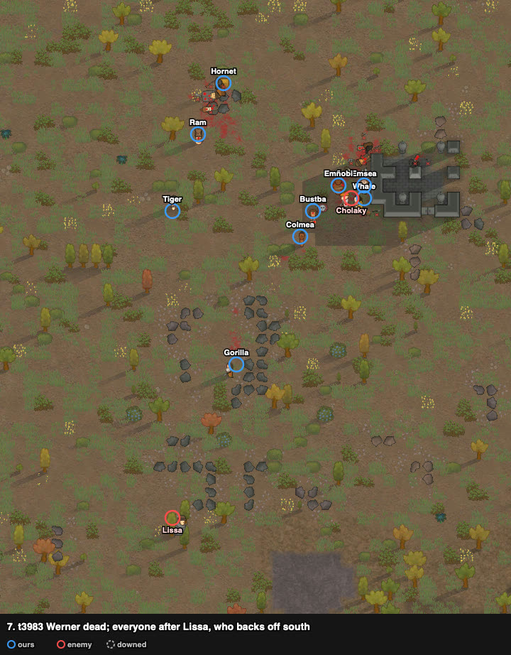
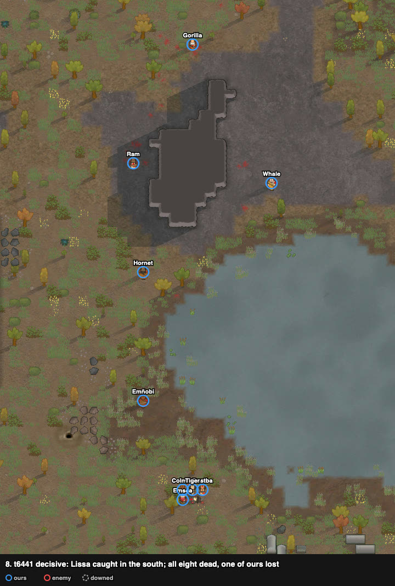

# rand_023: human + Claude's loadout vs agent (amove) and Claude, savage melee ×10 vs outlanders ×8 with a shooting-19 revolver

Worst-list #12. **Enemies cleared, decisive**: 1 of ours dead (Salamander), none downed; all
eight raiders dead. The agent's squad went down (2 dead, 8 downed), and so did Claude's (4
dead, 6 downed: the walled-hall breach failed and the squad was caught outside). The user
played it after work, and Claude watched.

**Problem.** arena_forest_night, Strive to Survive, 500 v 500 pt. Our squad starts at
(125, 125); the raid walks in from the south-west corner (32–44, 0–6), ~151 cells away.

| ours (10 savage tribals) | shooting / melee | weapon after the loadout |
|---|---|---|
| Whale | 2 / **11** | steel spear (Ram's) |
| Colmea | 4 / 6 | steel knife (poor) |
| Ram, Hornet | 2 / 5 | wooden club (Whale's) / steel spear |
| Bustba | 2 / 3, Tough | steel knife (poor) |
| Emsea | 0 / 3 | steel ikwa (poor) |
| Tiger | 7 / 3 | steel knife (awful) |
| Salamander | 1 / 2 | steel ikwa (awful) |
| Emñobi | 5 / 0 | wooden club |
| Gorilla | 0 / 0 | steel ikwa (awful) |

No armour.

Raid (8 civil outlanders):
- **Lissa:** revolver, **shooting 19**, flak vest + jacket.
- **Furr:** autopistol, 11.
- **Toni:** knife, melee 13.
- Cholaky (autopistol), Van and Jenn (pump shotguns), Nytro (machine pistol, Slowpoke), Werner
  (good revolver).

## Result

| | human + loadout | Claude | agent (amove) |
|---|---|---|---|
| outcome | **enemies cleared, decisive** (t5889) | squad down | squad down (t3051) |
| lost | **1** (Salamander) | 4 dead | 2 dead |
| downed at end | **0** | 6 | 8 |
| permanent injuries | 0 | – | 9 |
| raiders dead | **8 of 8** | – | 2 |
| HP lost (sum) | 391% | – | 745% |
| badness | **25.6** | 100.2 | 101.8 |

## The player's reading and intents (as told after the battle)

1. **The small ruin:** the squad waited hidden there, packed. Both choices were on purpose: to
   hide, and to let the raid string out. The worst threat (Lissa) arrived late as a result.
2. **Two teams, on purpose:** Whale and Hornet were the damage dealers of the two groups; the
   rest were meat shields.
3. **Lissa:** Gorilla was a good pawn to send to melee-lock her, since his own damage was low.
4. **Toni:** handled passively. He came in before the squad left its hidden spot and was killed
   there for free. With our numbers, he was not counted a big threat.
5. **When to leave the ruin** (told after Claude's replay): cells that cover hides from a raider's
   gun are not shot at. The player traced the raiders' sight and set off when the walk to the
   marked shooters, counting only the exposed cells, became the shortest. Both groups had to set
   off together: if the raid hugs the north side, the group going round the south has a long way.
   The signal was Toni, the raid's front: the squad did not set off until he had come in and was
   hitting ours (his first blow t2397 at the ruin's west edge, the squad off at t2459). Where he
   died, inside the ruin at (147, 111), shows the fight with him happened before the squad left.
   Team 1 went round clockwise and team 2 counter-clockwise; team 2 was sent first, so that both
   came into the shooters' sight at the same moment.

## Route

From the trace. The squad walked ~25 cells east-south-east to the small ruin and waited there.
The raid came north-east from the corner straight at it, strung out, with Lissa far behind.
At the end the squad chased Lissa ~80 cells south.

## Timeline

All ten packed inside the small ruin's low walls (145–150, 108–111) and waiting; the raid 65
cells away, Lissa ~100.

The raid strung out on the way in: Toni (knife) at 4 cells, Furr at 6, the shotguns at 9–11,
Nytro, Cholaky and Werner at 14–16, Lissa 53 cells behind.

**Contact.** One of ours on each shooter (Emsea–Furr, Hornet–Van, Colmea–Toni, Whale–Jenn), and
Whale's group of four (Whale, Ram, Salamander, Gorilla) went round the south side of the ruin.

**Toni dead**: he had run in before we came out and was ganged there. Two groups, each with a
dealer: Whale's on Nytro and Cholaky, Hornet's on Werner. Lissa 30 cells out.

**Van dead; Salamander dead**: a head shot from Lissa's revolver (shooting 19) at ~23 cells, as the
player saw in the game's UI. Lissa had stopped at (128, 88) and was shooting from there. Gorilla
(melee 0) was sent to lock her.

**Furr, Jenn and Nytro dead.** Whale held Cholaky (41%), Hornet held Werner (54%). Lissa was still
at 100%, out of reach.

**Werner dead.** Everyone was ordered on Lissa, who backed off south; Cholaky (21%) died soon after.

**Lissa caught and killed in the south: all eight dead, t5889.** None of ours downed.

## What it showed (observations)

1. **The concealed wait made the raid arrive strung out**, worst threat last. The front ran
   into ten waiting pawns: Toni (knife, melee 13) died in the ruin without a lock being needed.
2. **Every shooter was marked at contact**, as in the user's rand_015, plus a flanking group of
   four. Two dealers (Whale melee 11, Hornet) led groups of meat shields.
3. **The revolver ace held at range** (23 cells) and was left to a low-damage locker (Gorilla)
   until the rest were dead, then hunted down by everyone.
4. The only loss (Salamander) was the worst threat's: Lissa's revolver hit him in the head from
   ~23 cells while the rest were locked at the ruin. No one was downed.

## Data

- row: `results/human/play.jsonl` (rand_023, player `human`); agent row: `results/night/router.jsonl`
- trace: `../traces/rand_023_human_20261005-184759.jsonl.gz`
- watcher records (`tools/watch.py`): `../raw/rand_023/`; frames: `../raw/build_reports.py`
- case card: `results/cases/cards/rand_023.md`; Claude's attempt: `results/cases/journals/rand_023_claude_20261005.md`
