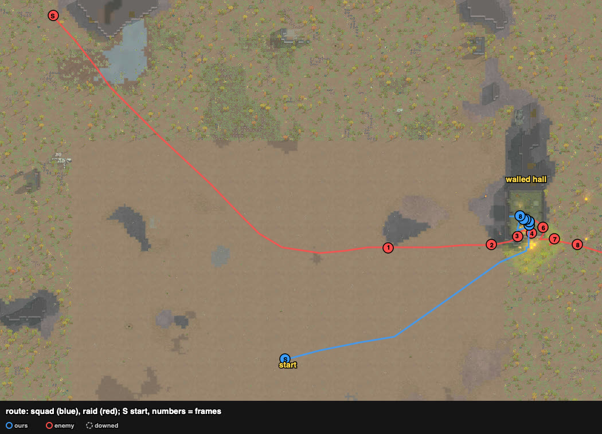
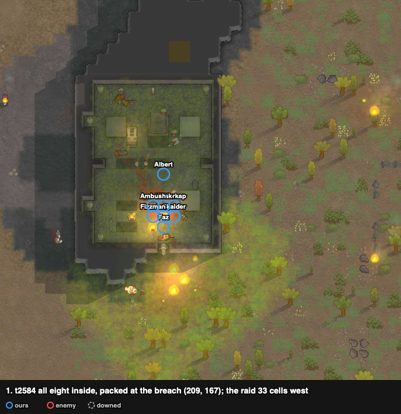
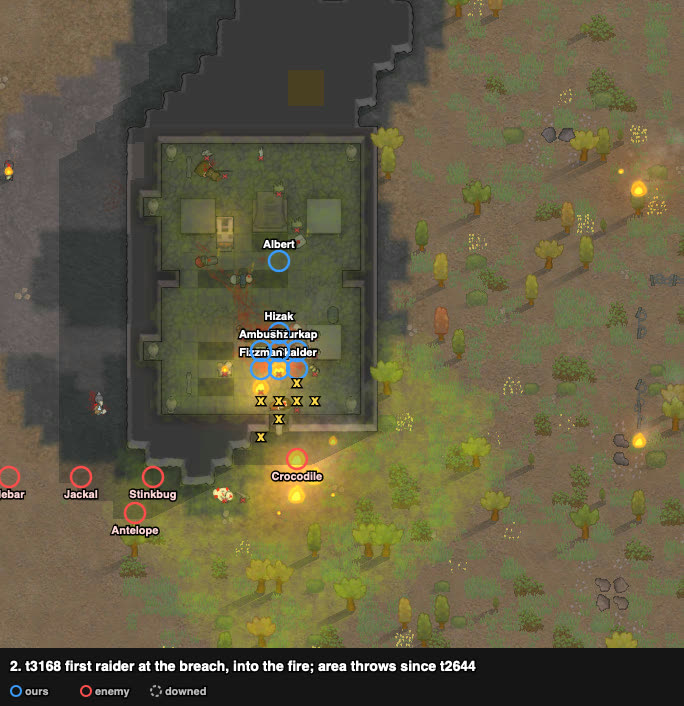
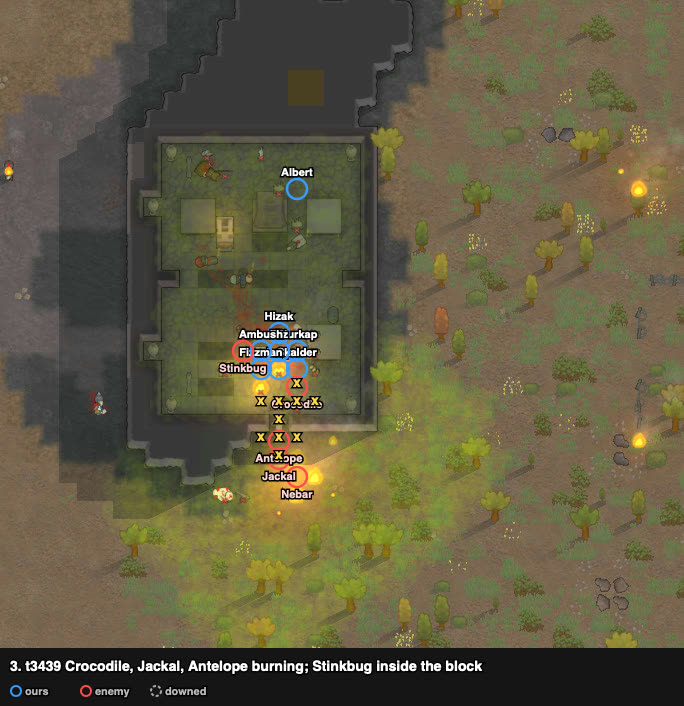
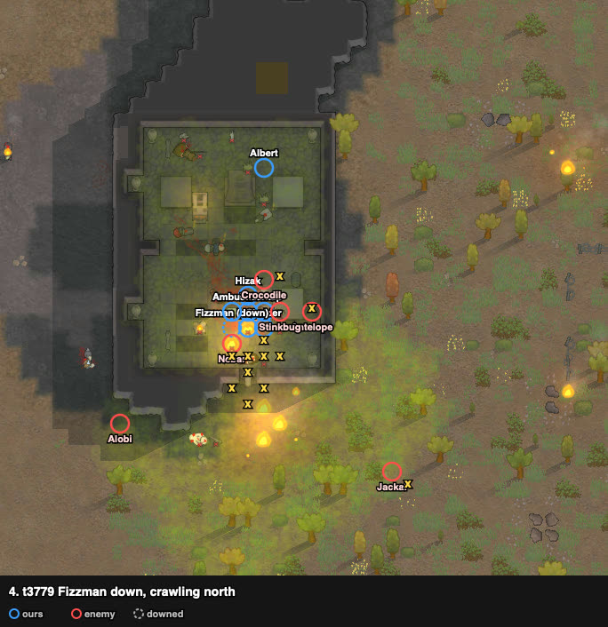
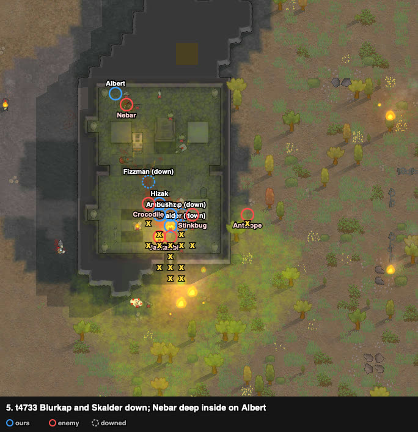
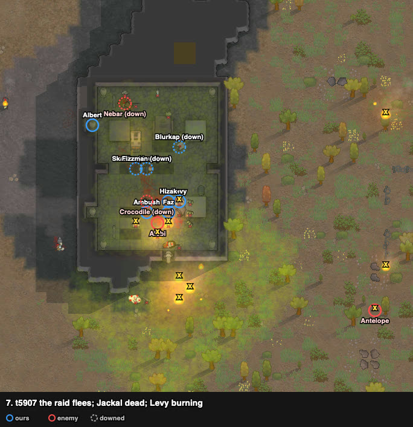
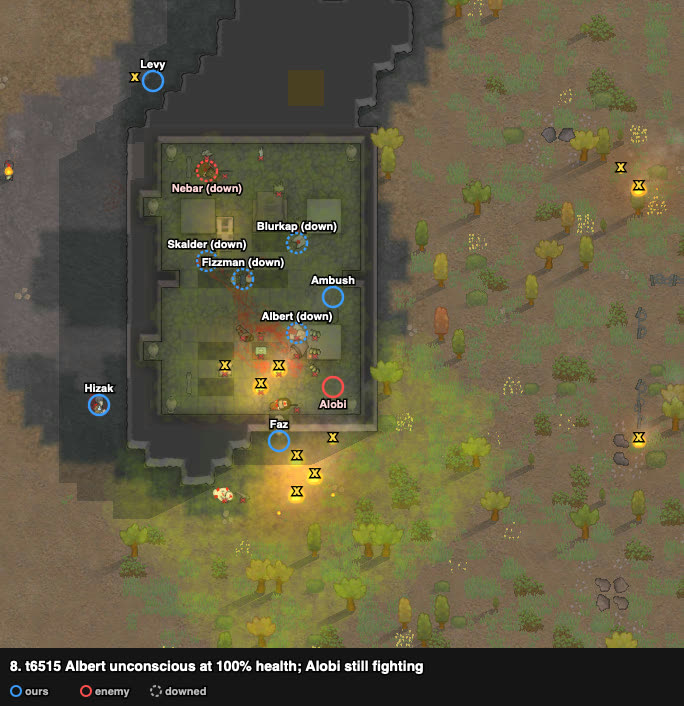

# rand_115: human vs agent (kite) and Claude ×3, Waster tox throwers ×8 vs Neanderthal melee ×6

**Enemies cleared, repelled** (t7041): none of ours lost, 4 downed at the end (Fizzman, Blurkap,
Skalder, Albert). Three raiders dead (Stinkbug, Jackal, Crocodile), two downed (Nebar, Alobi), and
Antelope fled. The first win on this problem: the agent lost by kiting (squad down), and so did
Claude three times, twice in the big ruin's room R2 (lost to kidnaps)
and once kiting with gas on open ground. The user played on 2026-10-18 and Claude watched.

**Problem.** arena_open_night, Strive to Survive, 500 v 500 pt. Our squad starts at (125, 125);
the raid walks in from the north-north-west edge (37–49, 242–247), ~145 cells away.

| ours (8 Wasters) | shooting / melee | weapon |
|---|---|---|
| Hizak | 8 / 8 | molotov cocktails |
| Fizzman | 9 / 5 (moving 82%) | tox grenades |
| Levy | 3 / 6 | tox grenades |
| Ambush | 2 / 4, drill arm | tox grenades |
| Faz | 1 / 2 | tox grenades |
| Blurkap | 0 / 1 | tox grenades |
| Skalder | 0 / 0, elbow blade | tox grenades |
| Albert | 0 / 2, elbow blade, **not tox-immune** | tox grenades |

No guns, no melee weapons. Raid (6 Neanderthal tribals, all melee):
- **Antelope:** steel ikwa, melee 8.
- **Crocodile:** steel knife, 6, Jogger.
- Alobi (ikwa, 5), Jackal (granite club, 5), Stinkbug (marble club, 2), Nebar (spear, 1, berserker).

## Result

| | human | Claude 1 (R2) | Claude 2 (R2) | Claude 3 (open) | agent (kite) |
|---|---|---|---|---|---|
| outcome | **enemies cleared, repelled** | defeat | defeat | defeat | defeat, squad down |
| lost | **0** | 1 dead + 1 kidnapped | 2 kidnapped | 3 dead + 3 kidnapped | 1 dead |
| downed at end | 4 | 3 | 3 | 2 | 7 |
| permanent injuries | 7 | 8 | 7 | 6 | 10 |
| health lost (sum) | **337%** | 396% | 394% | 723% | 594% |
| badness | **39.5** | 70.8 | 68.8 | 116.9 | 84.8 |

Badness is `rca.eval.ranking.badness` as it is today (a kidnapped pawn counts once); the card's
older Claude numbers counted each kidnap twice.

## The play

From t28 (the second poll) Ambush, undrafted, carried a job to deconstruct the walled hall's south
wall cell (209, 167). He walked there with the other seven, who went drafted, ~95 cells north-east
to the hall's south side, and started the work on arrival. The raid came in a line from the north-west and then along z 162–165,
straight at the hall's south-west corner.

## The player's intents (told after the battle)

- **The molotovs were deliberate.** A raider set alight on impact moves about trying to put the
  fire out, breathing the gas, instead of attacking ours in melee, so the damage goes up. Burning
  ground takes the raid's way in away for a while, or makes it longer: less potential damage to
  ours and more gas damage to them.
- **Albert and the wall.** Albert, the only one who is not a Waster, looked unable to survive
  inside the room, and more tox from him would not have helped the repel. He hit the wall so that,
  if it broke, he could get out and live, to cut the badness at least: the fight had tilted well
  our way by then, so getting out was enough to survive and keep the badness down.

## Timeline

Frames: positions and fire cells (yellow x) from the trace, drawn on one screenshot of the hall
taken after the battle, so the walls show the breach already open and the ground shows the fires
and gas of the end.

**The breach.** Ambush was at the wall by t1649, and the job ended at t2221 (~570 ticks of work)
while the seven waited on (208–210, 161–163). All eight went in by t2404; seven packed on
(208–210, 169–172), right inside the gap, and Albert, the one without tox immunity, stood further in.

**Area orders and fire first.** At t2644, with the raid's front 33 cells west, everyone but Hizak
went on attack-area orders, and Hizak joined by t2775 (the target cells and the tox grenades in
flight are not in the trace). Hizak threw molotovs from ~t2860; the breach cells burned by t2946.
Crocodile reached the gap at t3168–3241, ~520–600 ticks after the area orders began and ~310–380
after the first molotov.

**The raid burns.** Crocodile, Jackal and Antelope burned at the breach ("wandering" with a fire on
their own cell, then "extinguishing fire on" themselves). Stinkbug walked into the block and stood
at (211, 171).

**Fizzman down** (~t3779), with Nebar on the cell next to him. He crawled north ("Crawling to
safety") to (207, 175). Albert was at the hall's north end, (210, 180).

**Blurkap (~t4590) and Skalder (~t4730) down**, Stinkbug and Alobi beside them. Both crawled
north into the hall. Nebar went deep into the hall and met Albert at (204–205, 181–182).
Hizak went to melee from ~t4275.

**Stinkbug dead** at (210, 171) by t5252, at 100% health in every poll up to t5175 (the trace has
no hediffs, so the cause is not shown). Crocodile lay unconscious at 80% (by t4822), Nebar down next
to Albert. Levy stood on a burning cell, (209, 170), in every poll from t4909, with Alobi attacking
him from the next cell (t4822–5655).

**The raid flees** (t5907). Jackal, last seen at (205, 162) at t5823, had died just before (the
watcher's corpse list: (206, 163)); Antelope, burning, went east. Levy (76% by t5512), "wandering"
with a fire moving with him from t5596, went out through the breach (~t6037) and round the hall to
the north. Alobi stayed just inside the breach against three of ours (Hizak, Faz, Ambush; melee
t5655–5914).

**Albert unconscious at 100% health** at (210, 172), by the breach, after coming there once the
raid had fled. Alobi, left alone after t5954, was downed in the breach at ~t6857. Faz had the job
"carrying Albert" and Ambush was tending Fizzman when the harness ended the battle (t7041).

## What it showed (observations)

1. **One wall cell, opened without weapons.** Claude's card had the breach sites closed to this
   squad: in its game the throw gizmo was the only attack offered with grenades held, nothing with
   them dropped, and deconstruction was not tried. Here deconstruction took ~570 ticks for one pawn;
   the job was set at the start, so Ambush walked with the squad and needed no order on arrival,
   and the seven waited outside while he worked. Albert, holding tox grenades, also melee-attacked
   a granite wall from t5257 (96% at t5427 → 81% at t5907).
2. **The area orders and the fire were at the gap before the raid.** The area orders started
   ~520–600 ticks before the first raider reached it; from t3168 to the end 7–17 cells burned, most
   within 4 cells of the breach. Five of six raiders had a job of putting out fire on themselves at
   some point.
3. **No kidnap.** In Claude's R2 games downed pawns were carried off through the doors (in attempt
   2 while the fight went on). Here the three downed at the gap crawled 5–6 cells north into the
   hall, while the raiders inside had jobs of melee attacking, burning or putting themselves out.
   The trace does not show why none picked anyone up.
4. **Down or dead at high health.** Stinkbug was at 100% in his last poll (t5175) and dead by
   t5252; Crocodile (80%), Nebar (70%), Alobi (75%) and Albert, ours (100%), went down
   unconscious. Toxic buildup would fit, but the trace does not record hediffs.
5. **Our own fire.** The molotov fires spread into the hall. Levy stood on a fire cell from t4909
   while Alobi attacked him from the next cell, was at 76% by t5512, and then burned, with a fire
   moving with him, down to 51%.
6. **The cost:** four downed, 7 permanent injuries, 337% health lost in all; nobody lost.

## Data

- row: `results/human/play.jsonl` (rand_115, player `human`); agent row: `results/night/router.jsonl`
- trace: `../traces/rand_115_human_20261018-043556.jsonl.gz`
- frames: drawn from the trace on two screenshots taken after the battle (no watcher records)
- case card: `results/cases/cards/rand_115.md`; Claude's games: `results/cases/journals/rand_115_claude_20261005.md`
