# rand_164: human (Claude's loadout) vs agent (close) and Claude, savage melee ×9 vs Neanderthal melee ×6

Second mining run, worst-list #4. **Enemies cleared, repelled**: none of ours lost, 3 downed
(Bacchus, Neabancocan, Red); four raiders dead (Gacan, Ambas, Mamen, Hornet), Blue and
Grasshopper fled. The agent lost (3 dead, 4 kidnapped) and so did Claude, in the west rock pocket
(1 dead, 3 kidnapped). The user played after Claude, with Claude's loadout, and Claude watched.

**Problem.** arena_forest_night, Strive to Survive, 500 v 500 pt. Our squad starts at (125, 125);
the raid walks in from the south edge (177–192, 0–6), ~135 cells away.

| ours (9 savage tribals) | shooting / melee | weapon after the loadout |
|---|---|---|
| Hakuja | 3 / **9**, Bloodlust | steel spear (Neabancocan's) |
| Bacchus | 7 / 7 | steel spear (Marulo's) |
| Red | 4 / 6 | steel spear (Frog's) |
| Chave | 8 / 5 | steel ikwa (poor) |
| Neabancocan | 1 / 4 | steel ikwa (poor, Hakuja's) |
| Marulo | 1 / 3 | steel knife (poor, Bacchus's) |
| Frog | 3 / 3 | steel ikwa (awful, Red's) |
| Lercroi | 2 / 2 | steel ikwa (poor) |
| Legua | 4 / 1, Kind | steel ikwa (poor) |

No armour. Raid (6 Neanderthal tribals, all melee):
- **Gacan:** steel ikwa (normal), melee 11.
- **Blue:** steel ikwa, 10.
- **Mamen:** steel spear, 7, berserker.
- Hornet (ikwa, 6), Ambas (knife, 4), Grasshopper (ikwa, 3).

Neanderthals are robust and feel little pain: in Claude's game they fought on at 17–27%.

## Result

| | human + loadout | Claude (same loadout) | agent (close) |
|---|---|---|---|
| outcome | **enemies cleared, repelled** (t8060) | defeat, raid left with 3 captives | defeat, raid left with 4 captives |
| lost | **0** | 1 dead + 3 kidnapped | 3 dead + 4 kidnapped |
| downed at end | 3 | 5 | 2 |
| permanent injuries | 15 | 0 | 7 |
| raiders dead | **4** (2 fled) | 1 | 1 |
| HP lost (sum) | 354% | 742% | 833% |
| badness | **53.2** | 124.7 | 173.3 |

## The player's reading and intents (as told after the battle)

1. **The bait's purpose was to buy time to break the wall.** It might not get back to the squad,
   so the player picked by these conditions: the lowest melee damage, little value, nothing wrong
   with its walking. (The pawn sent was Lercroi.)
2. **In this scenario the south wall would have done better than the east wall**: I think the
   window for the bait to come back in would have been open.
3. **The mouth:** ours stood at the breach in order of melee strength.
4. **I think there is no choice other than making 3:1 local fights keep happening.** If anything it
   is an easy problem: both sides have only melee, so the alternatives are much narrower.

## Route

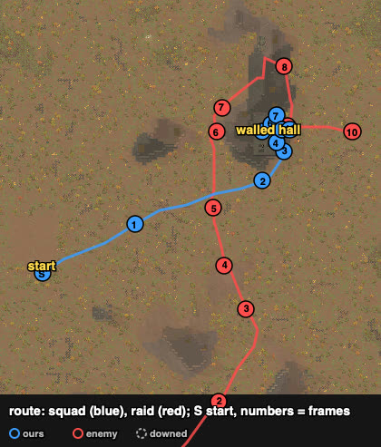

From the trace. The eight walked ~105 cells (straight line) north-east to the east wall of the
walled hall set against the NE ridge. Lercroi went south-south-east alone to (132, 90) and waited.
He then walked east across the raid's path to within ~20 cells of its front (t2171) and led three
raiders on a long loop: north-north-west to (157, 167), north-east round the ridge's north end to
(208, 218), then south down its east side to the breach (~290 cells in all). The raid's line here
is the centre of its two groups.

## Timeline

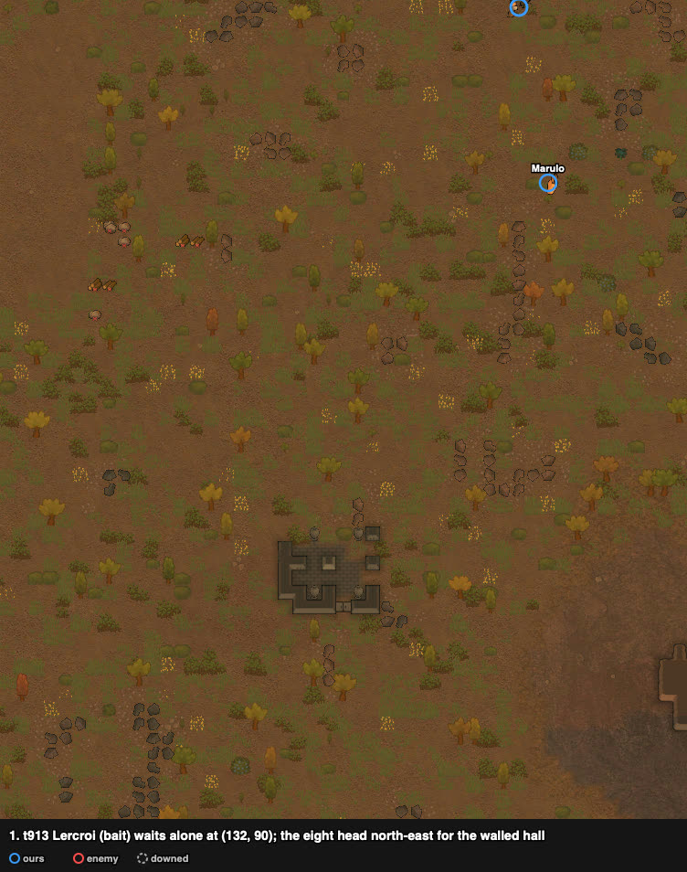
**The bait goes out.** From ~t213 Lercroi walks south-south-east alone, and by t913 he waits at
(132, 90). The eight head north-east for the walled hall (walls 202–214 × 167–183, no door). The
raid is 59 cells from Lercroi.

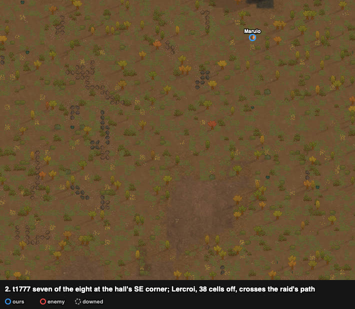
Seven of the eight are at the hall's south-east corner (Marulo ~13 cells back); they reach the
east side by ~t2000. The raid still walks north-east towards the hall; Lercroi, 38 cells from it,
walks east across its path.

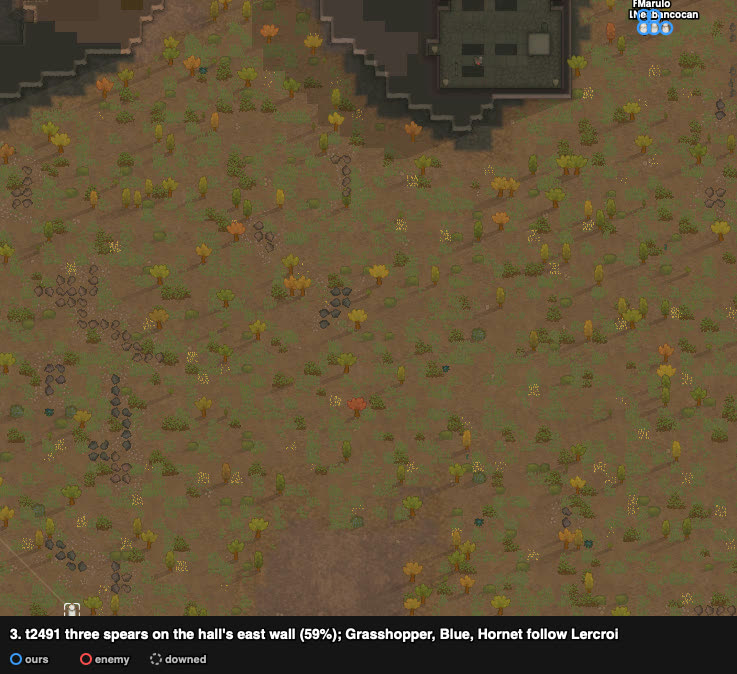
**Breaching.** Hakuja, Bacchus and Red (the spears) hit the east wall at (214, 177) from t2001; it
is at 59%; the other five wait. Grasshopper, Blue and Hornet turned on Lercroi (t2171–2346) and
follow him west. Gacan, Mamen and Ambas keep on north towards the hall.

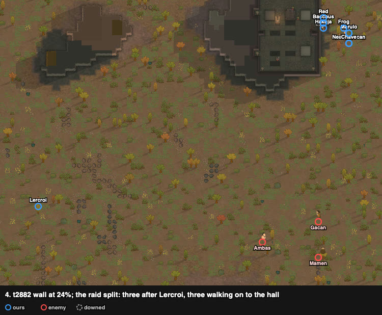
The wall is at 24%. **The raid has split**: three after Lercroi, 23–31 cells behind him; Gacan,
Mamen and Ambas 36–43 cells from our squad (29–36 from the hall's south wall).

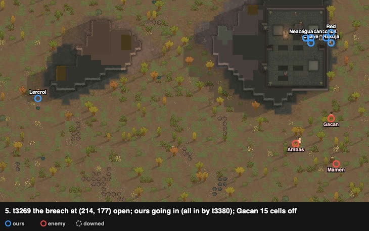
**The breach is open** (one cell, (214, 177); the wall broke between t3084 and t3159). Five are
inside, Bacchus is in the gap, and Hakuja and Red are coming through; all eight were in by t3380.
Gacan is 15 cells off.

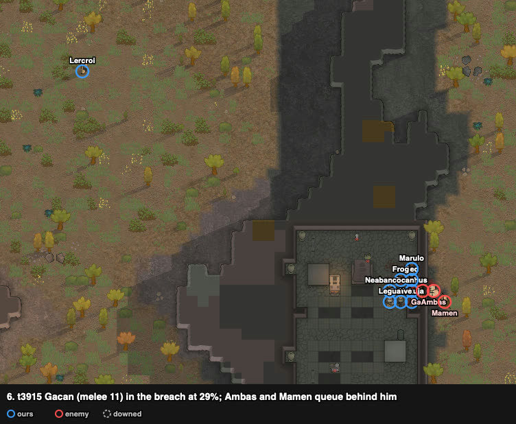
**Mouth hold.** Inside, by the breach: Hakuja (213, 176), Bacchus (213, 177), Red (213, 178), the
three spears; the rest behind them. Gacan (melee 11) is in the breach at 29%; Ambas and Mamen
queue behind him.

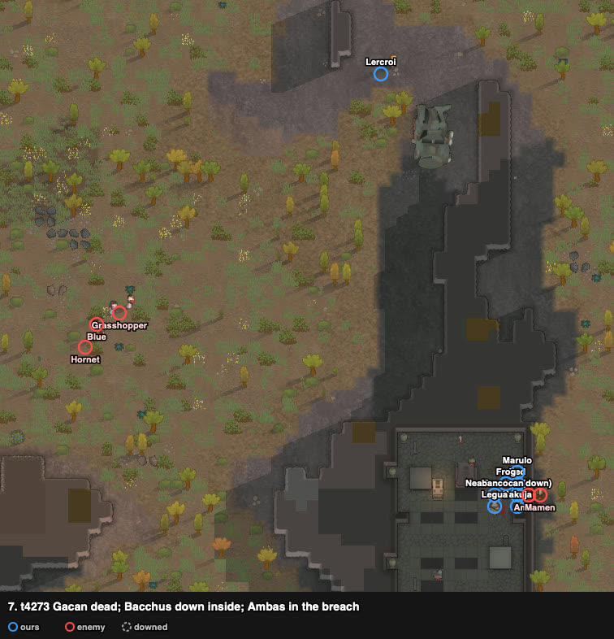
**Gacan dead** (~t3955). **Bacchus down** (t4125) at (213, 177); Chave (ikwa) took that cell from
t4238. Ambas is in the breach.

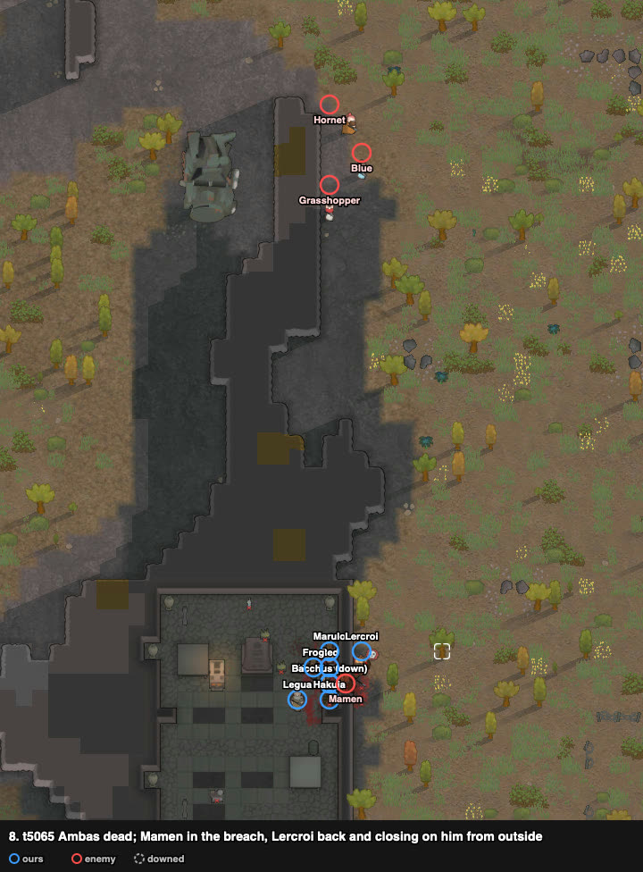
**Ambas dead** (~t4766). Mamen is in the breach at 52%. Neabancocan joined Chave on the middle
cell at t4763, tending Bacchus. Lercroi is back (t5004) and closing on Mamen from outside; from
t5111 he hits him from (215, 178). The three chasers are 29–34 cells behind Lercroi.

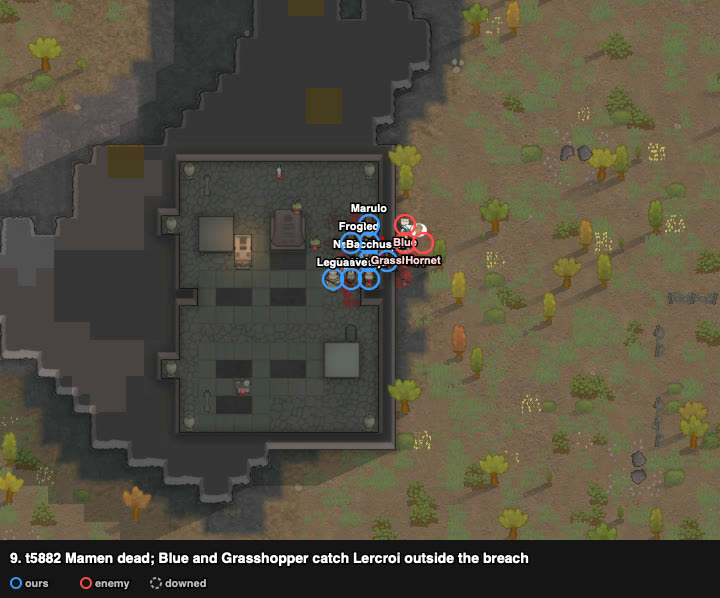
**Mamen dead** (~t5368). Bacchus got up (t5453). Blue and Grasshopper caught Lercroi outside at
(215, 178) (t5613); he went in through the gap (t5898–6178), and the three followed him to it.

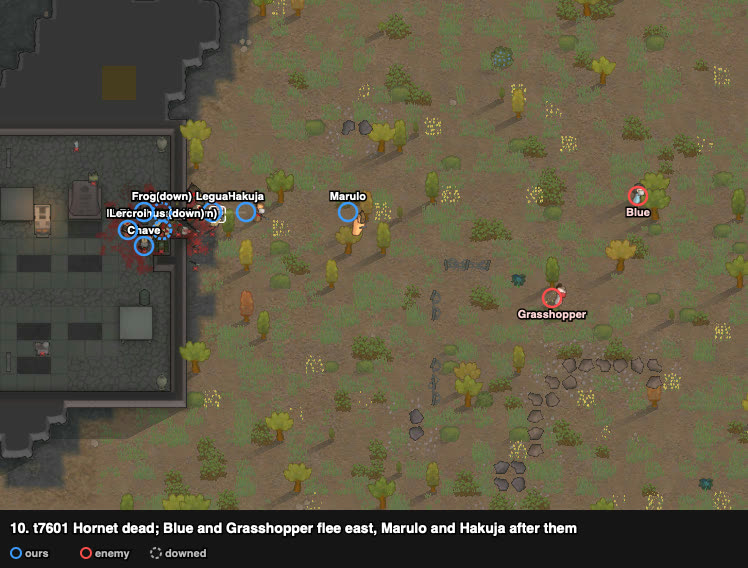
**Bacchus downed again** (~t6178): up without a weapon (drafted at t6042), he stepped into the gap.
**Neabancocan down** (by t6916). **Hornet dead** in the breach and **Red down**, both between
t6952 and t7270. Blue and Grasshopper (both 100%) flee east; Marulo and Hakuja go after them.
Enemies cleared at t8060.

## What it showed (observations)

1. **The bait split the raid three and three.**
   - Lercroi was away ~4800 ticks (left ~t213, back t5004). Grasshopper, Blue and Hornet followed
     him from t2171–2346 until they reached the breach at ~t5573: ~3300 ticks.
   - Gacan, Ambas and Mamen kept walking to the hall at ~17–19 ticks per cell. They reached the
     breach at ~t3540, ~400 ticks after the wall broke (t3084–3159). The three chasers came ~2000
     ticks after them, when they were dead.
   - The trace does not show whether the breach would have been late without the bait; buying
     that time was the player's purpose.
   - Claude, before its own game, had weighed the hall in the session (not in its sheet): 75
     steps for us and 160 for the raid to the hall's south-west corner. It ruled the hall out
     because a granite breach by three hitters looked too slow.
2. **The breach made the fights one raider at a time.**
   - Gacan met the three spears at (213, 176–178).
   - After Bacchus went down (t4125), Ambas, Mamen and Hornet met Hakuja and Red with an ikwa in
     the middle cell: Chave, then Neabancocan.
   - Marulo stood beside Red at (213, 179); the rest stood behind.
3. **Two groups, two turns:** the first group died in the breach (Gacan, Ambas, Mamen) before the
   bait brought the second. That one lost Hornet, and its last two fled.
4. **The cost:** four downings (Bacchus twice), three downed at the end, 15 permanent injuries;
   nobody lost.
5. **Contrast with Claude's game (same loadout):** in the open pocket the raid came as one body and
   split round a rock, and ours went down at 30–40%. One raider died there.

## Data

- row: `results/human/play.jsonl` (rand_164, player `human`); agent row: `results/night/router.jsonl`
- trace: `../traces/rand_164_human_20261006-044240.jsonl.gz`
- watcher records (`tools/watch.py`): `../raw/rand_164/`; frames: `../raw/build_reports.py`
- case card: `results/cases/cards/rand_164.md`; Claude's game: `results/cases/journals/rand_164_claude_20261005.md`
