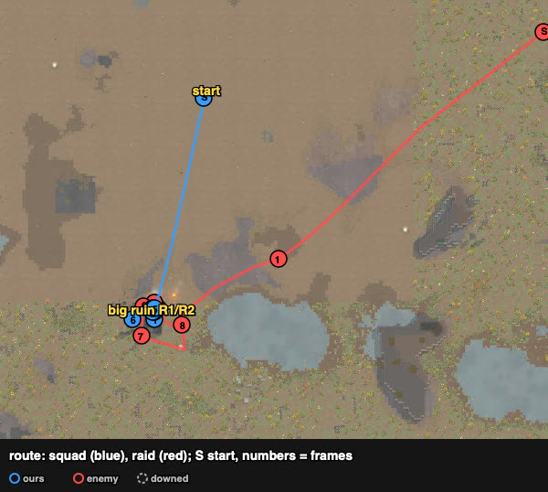
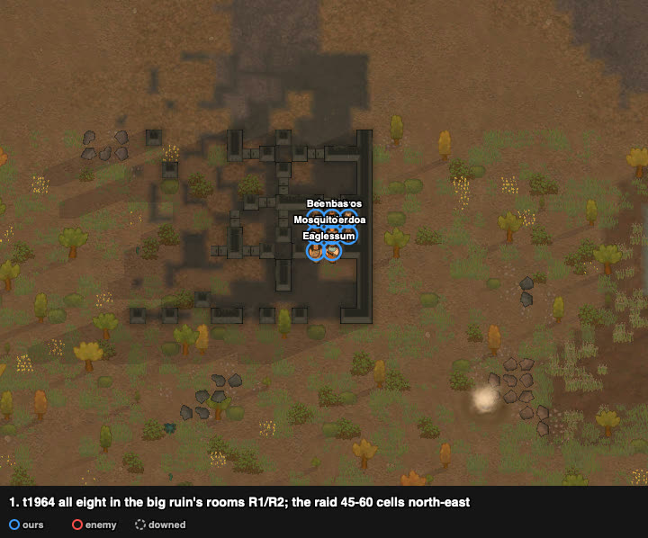
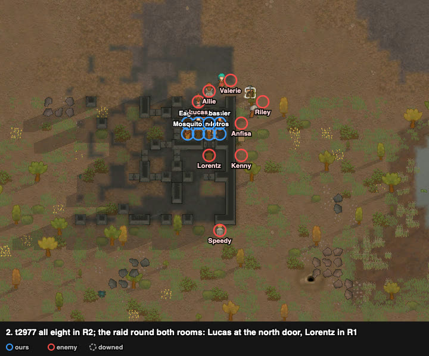
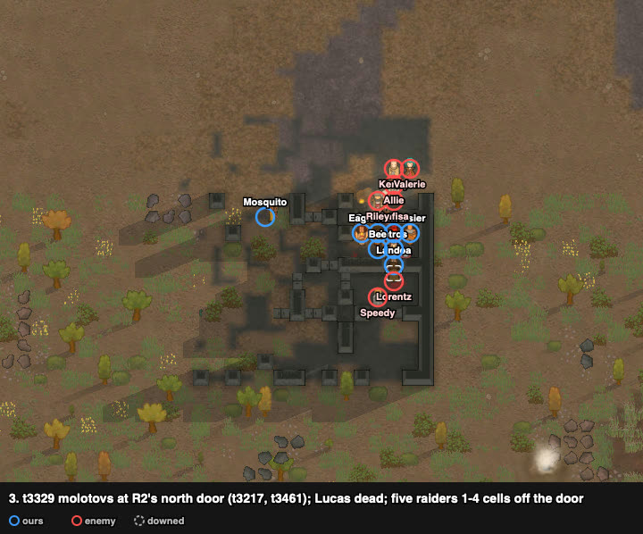
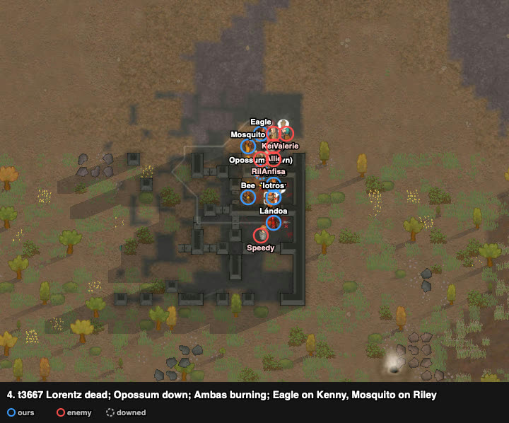
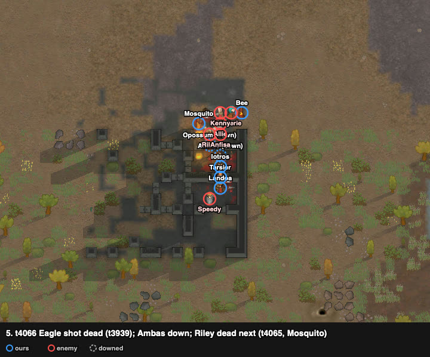
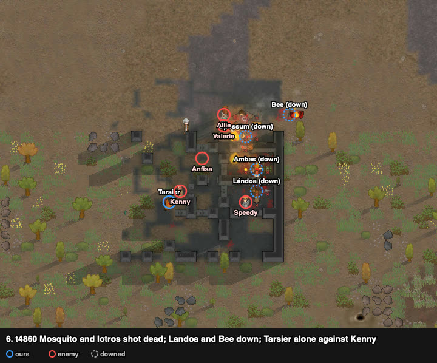
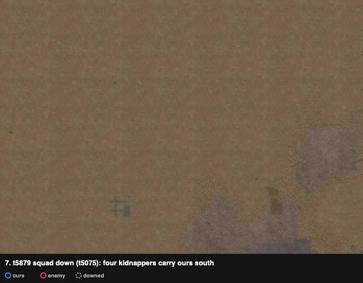
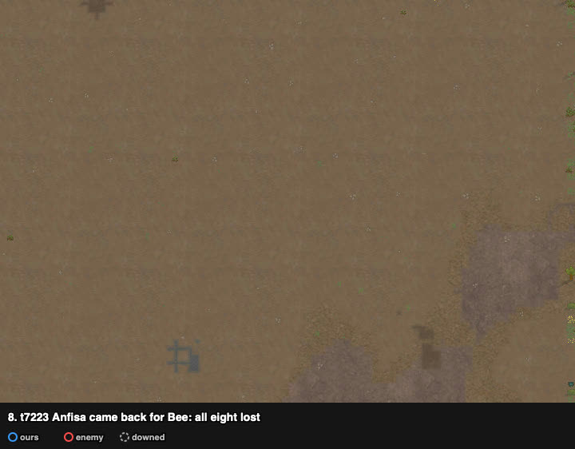

# rand_190: human ×2 vs agent (amove), savage tribe ×8 (bows, pila, one ikwa) vs rough outlanders ×8 with a molotov and a Hussar revolver

Attempt 2 (the big ruin's rooms, all eight lost, 172.0) is at the end.

Second mining run, worst-list #2. **Defeat, the raid left with captives**: 3 of ours dead
(Iotros, Lándoa, Bee), 2 kidnapped (Opossum, Mosquito), 3 downed at the end; four raiders dead
(Lucas, Allie, Lorentz, Speedy). The agent lost 1 dead and 7 kidnapped. The user played it
first, with no Claude attempt before, and Claude watched.

**Problem.** arena_open_night, Strive to Survive, 500 v 500 pt. Our squad starts at (125, 125);
the raid walks in from the east edge (244–249, 143–158), ~125 cells away.

| ours (8 savage tribals) | shooting / melee | weapon after the loadout |
|---|---|---|
| Tarsier | **10 / 10**, Fast walker, Bloodlust | greatbow (Bee's) |
| Eagle | 3 / **12** | pila (Mosquito's) |
| Opossum | 0 / 8, Brawler | steel ikwa |
| Lándoa | 5 / 2 | pila |
| Mosquito | 0 / 3 | short bow (Eagle's, poor) |
| Bee | 2 / 4 | recurve bow (Tarsier's) |
| Iotros, Ambas | 3 / 2 | recurve bows (Ambas's poor) |

No armour.

Raid (8 rough outlanders):
- **Kenny:** revolver (poor), shooting 8, melee 11; a **Hussar** (seen by the player in the game UI).
- **Valerie:** bolt-action rifle (good), shooting 1.
- **Riley:** molotov cocktails, steel helmet.
- **Allie:** revolver (good), 7/0, flak jacket and pants.
- **Anfisa:** pump shotgun, flak vest.
- **Speedy:** machine pistol, Trigger-happy, Jogger, flak jacket.
- **Lorentz:** revolver (awful).
- **Lucas:** steel knife, melee 1.

## Result

| | human | agent (amove) |
|---|---|---|
| outcome | **defeat**, raid left with 2 captives (t13967) | defeat, raid left with 7 captives (t7496) |
| lost | 3 dead + 2 kidnapped | 1 dead + 7 kidnapped |
| downed at end | 3 | 0 |
| permanent injuries | 7 | 0 |
| raiders dead | **4** (+ Anfisa downed, got up and left) | 1 |
| HP lost (sum) | 672% | 800% |
| badness | **129.9** | 192.0 |

Attempt 2 (below): defeat, all eight lost (3 dead, 5 kidnapped), three raiders dead, badness 172.0.

## The player's reading and intents (as told after the battle)

1. **The west wall ruin:** whatever happened, the squad should be hidden from part of the
   raid's lines of fire.
2. **Pila to Eagle** (melee 12): the game's stats showed the pila's melee damage higher than
   the short bow's.
3. **The gang on Anfisa** at contact: the player did not recall who she was.
4. **Ambas on Valerie**, as with Gorilla on Lissa in rand_023: the bolt-action rifle should
   not keep dealing free damage from long range.
5. **What went wrong:** the Hussar pistol shooter (Kenny) did too much damage. The player
   expected a melee lock on him to work, and lost three of ours, one after another.

## Route

From the trace. The squad walked ~90 cells west to the west wall ruin (wall at x 39–43,
z 82–94) and waited west of it. The raid came west after it along z 95–119, strung out, and
the fight stayed by the wall. At the end the kidnappers left by the west edge.

## Timeline

**Loadout and walk.** Greatbow to Tarsier, pila to Eagle, short bow to Mosquito. The squad
is behind the west wall; the raid is strung out 62–79 cells east.

Waiting west of the wall. Speedy leads at 29 cells; Valerie (rifle) is 50 behind.

**Contact.**
- Riley's first molotov landed next to ours (t3736; fire at (36, 83)).
- Lucas (knife) ran in and died.
- Iotros was hit by Anfisa's shotgun at 4.5 cells.

**Iotros dead** (shot, t4000). All seven of ours on Anfisa (shotgun, the raid's front).

**Anfisa down** (t4480). Then one of ours on each shooter:

| ours | on |
|---|---|
| Tarsier (greatbow) | Riley (molotovs), 13 cells away |
| Eagle, Bee | Allie |
| Lándoa, Opossum | Lorentz |
| Mosquito | Kenny (stopped on the way by Speedy, t4627) |
| Ambas | Valerie (rifle), 26 cells away |

The grass is burning. **Bee down** (t5154, Lorentz). Ambas has locked Valerie. Opossum
walks at Kenny, who holds at (45, 107) at 100% and shoots.

**Allie and Lorentz dead.** **Opossum down** at (45, 104), 3 cells from Kenny (t5295).

**Speedy dead** (Mosquito).
- **Eagle down** (t6002) at (50, 97), on the way to Kenny.
- **Lándoa down** (t6219) at (45, 104), the same cell as Opossum, 3 cells from Kenny; he
  **burned to death** there (t6275).
- **Tarsier down** to Riley (t5914).
- Kenny is still at 100%.

**Kidnap and leave** (t6817). Ambas went down at Valerie (t6448).
- Kenny carries Opossum, and Valerie carries Ambas.
- Anfisa, downed at t4480 and not finished, got up and walked off.
- Riley threw again at t6162, t7177 and t7437, once his locker was down.

**Squad down** (~t7800, when Mosquito, the last standing, fell next to Riley).
- **Opossum kidnapped** (t8202, Kenny) and **Mosquito kidnapped** (t9854, Riley).
- Valerie dropped Ambas to put out a fire on herself, then picked up Eagle.
- Tarsier got up and went after her alone.
- **Bee**, downed in the burning grass and unable to crawl, **died of burns** (t10993).

## What it showed (observations)

1. **The lockers went at Kenny one at a time, and none reached him.**
   - Opossum was sent at t4627 and downed at t5295.
   - Eagle was sent at t5476 and downed at t6002.
   - Lándoa was sent at t5622 and downed at t6219.
   - Two of them fell on the same cell, 3 cells from him. Kenny held one spot, shot each of
     them on the approach, and stayed at 100% until he left with a captive.
   - The trace shows him at "watching for targets" all along.
2. **The rifle's lock held:** Ambas walked 26 cells to Valerie and held her for ~1200 ticks
   (Valerie 100 → 49%). Valerie did not shoot meanwhile.
3. **The molotov was locked late.** Tarsier (the best bow) was sent 13 cells to Riley after
   two throws and held him until he went down (t5914). Riley threw three more times after that.
4. **The fire killed two:** the west strip is grass and trees. Fires grew from 1 to 75 cells,
   and Lándoa and Bee died of burns while downed in it.
5. **Downed and not finished:** Anfisa (shotgun, downed by the gang of seven) got up ~2300
   ticks later and walked off the map.
6. **Kidnapping** came once five of ours were down. Of the four raiders still standing, three
   carried pawns off; Valerie swapped her captive for Eagle.

## Attempt 2: the big ruin's rooms — all eight lost

Row `results/human/play.jsonl` (rand_190, player `human`, second row) · trace
`../traces/rand_190_human_20261005-201645.jsonl.gz` · watcher `../raw/rand_190/b*`.
**Defeat, raid left with captives** (t9479): **3 dead** (Eagle, Mosquito, Iotros, all shot),
**5 kidnapped** (Ambas, Tarsier, Opossum, Lándoa, Bee); three raiders dead (Lucas, Lorentz,
Riley) · HP 800% · **badness 172.0**.

### The player's reading and intents (as told after the battle)

1. **The rooms as a choke point**, but the molotov and the shotgun were hard counters to it.
2. **No loadout:** ranged weapons mean almost nothing here; the fight is about how well the
   melee locks are made.
3. **The raid was hoped to split in half** between the rooms' sides; it took bad positions for us.
4. **A strategic choice with a very narrow window,** and the squad did not get into it.

### Route

The squad walked ~80 cells south-south-west to the big ruin's rooms R1/R2 (104–107, 43–47) and
waited there. The raid came south-west straight at the rooms. The kidnappers left by the south
edge.

### Timeline

All eight inside rooms R1/R2. The raid is 45–60 cells north-east.

**Contact.** All eight inside R2 (104–107, 46–47). The raid came round both rooms:
- Lucas (knife) at R2's north door, on Opossum;
- Lorentz inside R1, south of R2;
- Anfisa, Kenny, Allie, Valerie and Riley 2–4 cells east and north.

**Two molotovs at R2's north door** (t3217, t3461), burning at the door.
- **Lucas dead.** Lándoa, Iotros and Bee on Lorentz.
- Anfisa (shotgun), Riley, Allie, Kenny and Valerie stood 1–4 cells off the north door
  (105–107, 49–51), shooting in.
- Speedy entered R1.

**Lorentz dead. Opossum down** (t3630). Ambas is burning. Eagle went on Kenny, and Mosquito
on Riley outside the north door.

**Eagle shot dead** (t3939) by Kenny's door. **Ambas down** (t3726). **Riley dead** soon after
(t4065, Mosquito).

**Mosquito shot dead** (t4281) and **Iotros shot dead** (t4757). Lándoa and Bee down (t4227).
Tarsier, the last standing, was alone against Kenny in melee; **down t5075**.

Squad down: four kidnappers carried Ambas, Lándoa, Tarsier and Opossum south.

**Anfisa came back for Bee**, who was crawling alone: all eight lost (t8753).

### What it showed (observations)

1. **The doors were not choke points against this raid.**
   - The molotovs landed at R2's north door and burned there.
   - Five raiders stood 1–4 cells off that door and shot in, among them the shotgun, Kenny and
     the rifle.
   - Three raiders came in by R1. Of the eight, three died to gunfire, from inside the rooms or
     at the north door.
2. **Kenny again was not locked.** Eagle went to him and was shot dead by his door, and
   Tarsier met him last, alone. Kenny was at 65% when he left with Tarsier.
3. **Squad down in ~2300 ticks from contact** (t2752–5075); attempt 1 took ~4000.
4. With no one standing, the raid carried five off. One raider, Anfisa, came back for the last
   crawler.
5. In rand_012 the same rooms held, one raider per door, but that raid was mostly melee
   (Yttakin blades and boars, one rifle), with no molotov and no shotgun.

## Data

- row: `results/human/play.jsonl` (rand_190, player `human`); agent row: `results/night/router.jsonl`
- traces: `../traces/rand_190_human_20261005-194933.jsonl.gz` (attempt 1), `../traces/rand_190_human_20261005-201645.jsonl.gz` (attempt 2)
- watcher records (`tools/watch.py`): `../raw/rand_190/` (attempt 2: `b*`); frames: `../raw/build_reports.py`
- case card: `results/cases/cards/rand_190.md`
